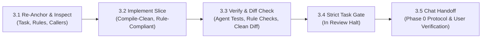

# Phase 4 — Lifecycle Build

## 1. Purpose

> **Core Mental Model:** One task at a time. Follow the rules. Verify with evidence. Ship only what was approved.

Implement the approved Implementation Plan from Phase 3 (`lifecycle/03-plan.md`) by following the defined technical approach, project conventions, and assigned Rule Files.

The Agent must re-anchor to the active task, inspect existing callers and code before writing, implement focused slices incrementally, maintain code hygiene, and verify all automated checks before presenting work for human review.

Tasks are executed strictly one task at a time. The Agent must stop for explicit human review and approval after every individual task before starting the next.

The Agent should continuously look for opportunities to improve the implementation, but must obtain user approval before making any improvement beyond what is required by the approved task—even a minor one.

---

## 2. Guiding Principles

- **Follow the Approved Plan:** Implement only the approved scope, touchpoints, and task sequence from `lifecycle/03-plan.md`. Do not silently add files or change architecture. If an architectural flaw or vulnerability is uncovered, follow the In-Flight Plan Amendment Protocol.
- **Instruction Re-Anchoring:** Before editing, re-read the active task in `lifecycle/03-plan.md`, its assigned Rule Files, and its verification criteria. Never rely on conversational memory across multi-task sessions.
- **Understand Before Changing (Caller & Seam Inspection):** Read target files and trace callers via read-only search (`grep`) before writing code. Know why the change is needed, what contracts must remain unbroken, and how success will be verified.
- **Rule Compliance Is Mandatory:** Read and apply all Rule Files assigned to the task (e.g. database migrations, file creation thresholds, security invariants). Verify compliance before review.
- **Red-Green Seam Proof (Proof of Cause):** For bugfixes and new logic, prove the seam: verify the failing behavior or error log before editing (Red), implement the targeted change, and prove the automated check passes after (Green). Never claim a fix works without proving the causal link.
- **Implement the Smallest Coherent Slice:** Keep changes focused, minimal, and compile-clean. Avoid horizontal fragmentation or sweeping refactors that touch unrelated files.
- **Pre-Handoff Diff Scrub (Hypo-Allergenic Diffs):** Audit `git diff` line-by-line before requesting review: ensure zero accidental whitespace modifications to untouched code, zero leftover `console.log`, `debugger`, or temporary shims, and zero orphaned imports. Every line in the diff must directly serve the task.
- **Honest Evidence Reporting (`Passed` / `Failed` / `Not Run`):** Never claim a check passed unless it was actually executed. Distinguish pre-existing baseline test failures from new regressions; never silently broaden scope to fix unrelated baseline issues.
- **Improve Proactively, Change Only With Approval:** Actively spot opportunities to improve code quality, performance, or security, but present them as recommendations in chat. Never implement extra changes without explicit user approval.

---

## 3. Responsibilities & Sequence

Implementation follows five disciplined steps:

---

### 3.1 Re-Anchor & Inspect Before Writing

1. **Re-Anchor to the Active Task**
   - Read `lifecycle/00-status.md` and `lifecycle/03-plan.md`. Identify the active `In Progress` task (or the next `Todo` task).
   - Re-read the task's **Blast Radius**, **Touchpoints** (files & planned changes), **Applicable Rules** (and specific sections), and **Agent Verification** commands.
2. **Inspect Callers & Target Files**
   - Read the target files in full—not just snippets.
   - Inspect immediate callers, routes, and data models via read-only searches to prevent broken contracts or unexpected side effects.
3. **Verify Baseline & Working Tree**
   - Run read-only `git status` to ensure no uncommitted or conflicting user edits exist.
   - Run relevant baseline tests if existing test suite failures are suspected, distinguishing prior failures from new regressions.

---

### 3.2 Implement the Focused Slice

1. **Write Minimal Coherent Changes**
   - Implement only what is required to satisfy the active task's scope.
   - Reuse existing application utilities and established patterns rather than duplicating logic.
2. **Maintain a Compile-Clean Slice**
   - Keep the codebase buildable and testable after each task.
   - If an early task renames a shared symbol, either update callers in the same task or introduce a temporary compatibility alias that is explicitly scheduled for removal in a subsequent task.
3. **Enforce Task-Specific Rules**
   - Apply the specific Rule Files assigned to the task (e.g., file-size limits, naming conventions, migration constraints).

---

### 3.3 Execute Verification & Verify Rule Compliance

1. **Run Agent Verification Commands & Red-Green Proof**
   - Execute the exact automated test and verification commands declared in `lifecycle/03-plan.md` under **Agent Verification**.
   - For bugfixes or logic changes, document the Red-Green evidence (failing before, passing after).
   - Record results honestly: mark each check as **Passed**, **Failed**, or **Not Run** (with rationale if unrun).
2. **Verify Assigned Rule Files**
   - Check the modified files against the assigned Rule Files (e.g. verify line counts do not breach file thresholds, verify migration rollback works cleanly).
3. **Execute Pre-Handoff Diff Scrub**
   - Run read-only `git diff` to inspect changes line-by-line.
   - Verify zero accidental whitespace edits, zero leftover debug statements (`console.log`, `print`, `debugger`), zero unused imports, and zero temporary mocks.

---

### 3.4 Strict Task-by-Task Gate

Phase 4 operates strictly **Task-by-Task**:
- **Strictly Serial:** Tasks are implemented strictly one at a time. Batching multiple tasks together is prohibited.
- **Never Leap Ahead:** Never begin coding a subsequent task while the current task is awaiting review or unapproved.
- **Pre-Review Gate:** When a task's implementation, automated agent verification commands, and diff scrub are complete:
  1. Check off each passing **Agent Verification** checkbox (`- [x]`) within the task in `lifecycle/03-plan.md`.
  2. Keep the main task checkbox unchecked (`- [ ]`) in `lifecycle/03-plan.md` (only the user checks this upon approval).
  3. Update the task row status to `In Review` in `lifecycle/00-status.md`.
  4. Stop calling tools immediately and request human review.

---

### 3.5 Present Task for User Approval

Follow the **Phase 0 Chat Approval Protocol**:
1. Present a concise 1–2 sentence summary of what was implemented and the automated verification results (`Passed` / `Failed`).
2. Provide the exact **User Verification** instructions from `lifecycle/03-plan.md`:
   - **Setup:** Starting environment state, running server command, or test account credentials.
   - **Action:** Exact steps for the user to execute in the app or terminal.
   - **Expected:** Observable outcome confirming the feature works.
3. Explicitly ask for user approval to advance to the next task.
4. Stop and wait for the user's explicit response before proceeding.
5. Upon user approval, mark the task `- [x]` in `lifecycle/03-plan.md` and set its status to `Done` in `lifecycle/00-status.md` before picking up the next `Todo` task.

---

### 3.6 In-Flight Plan Amendment & Architectural Discovery Protocol

When an architectural defect, security flaw, race condition, or broken contract is discovered during implementation:

1. **Halt Coding Immediately:** Stop writing code that implements an unworkable or vulnerable design. Never silently diverge from `lifecycle/03-plan.md` or bury the architectural flaw only in refine notes.
2. **Formulate Correction Proposal:** State the verified finding with concrete evidence (e.g., race condition, cache discrepancy, security vulnerability), explain why the current plan fails, and outline the adjustment to task scope, touchpoints, or sequence.
3. **Obtain Explicit Human Approval:** Present the proposal in chat. Stop and wait for explicit user approval before modifying the plan or proceeding.
4. **Update Upstream Source of Truth in Place:**
   - Update the affected task in `lifecycle/03-plan.md` (scope, files, and verification criteria) to match the agreed architecture.
   - If core requirements, security boundaries, or user flows were altered, update `lifecycle/01-discover.md` and `lifecycle/02-flows.md` in place.
   - Realign `lifecycle/00-status.md` if tasks were added, removed, or split.
5. **Resume Implementation:** Proceed with implementing the corrected task under the updated specification.

---

## 4. Completion Criteria

A task is ready for user review only when:

- Its approved scope and touchpoints have been implemented cleanly.
- All assigned Rule Files have been verified against the code changes.
- All automated **Agent Verification** commands have been executed and passed.
- Pre-handoff diff hygiene check is clean (no debug logs, dead code, or secrets).
- Any baseline test failure is clearly distinguished from new code behavior.
- The task checkbox remains unchecked (`- [ ]`) in `lifecycle/03-plan.md` while awaiting review; status in `lifecycle/00-status.md` is set to `In Review`.
- User Verification instructions (`Setup`, `Action`, `Expected`) are clearly provided.

Phase 4 (Build) as a whole is complete only when all tasks in `lifecycle/03-plan.md` are marked `- [x]` following explicit user approval and all rows in `lifecycle/00-status.md` are `Done`.

---

## 5. Exit Gate

Before advancing from one task to the next, or proceeding to Phase 5 — Finalize:

### Conditions for Exit Approval
1. All automated Agent Verification checks for the active task have passed.
2. Assigned Rule Files are satisfied with zero unapproved deviations.
3. Pre-handoff diff hygiene check is verified.
4. The user has reviewed the implementation and provided explicit approval in chat.

### Exit Gate Outcomes
- **Approved:** Mark the active task as `- [x]` in `lifecycle/03-plan.md` and set its status to `Done` in `lifecycle/00-status.md`. Proceed to the next `Todo` task, or advance to Phase 5 — Finalize if all tasks are complete.
- **Changes Requested:** User feedback requires modifications. Implement corrections in Phase 4, re-run verification and diff checks, and present the updated handoff.
- **Blocked:** An unpredicted architectural conflict, rule impossibility, or broken dependency is uncovered. Halt implementation and return to the owning earlier phase (Discover, Flows, or Plan) to resolve the contradiction.

### Requesting User Approval
Follow Section 3.5 and the **Phase 0 Chat Approval Protocol** to present verification evidence and request explicit user approval.

---

## 6. Phase Boundary

### 6.1 What Belongs to Phase 4 (Build)
- Re-anchoring to active tasks and assigned Rule Files in `lifecycle/03-plan.md`.
- Inspecting existing target files and callers using read-only search tools.
- Writing production application code, models, UI components, and tests.
- Executing automated Agent Verification commands.
- Verifying compliance with assigned project Rule Files.
- Checking `git diff` for code hygiene before handoff.
- Presenting clear User Verification instructions and obtaining explicit approval.

### 6.2 What Does NOT Belong to Phase 4
- Independently altering confirmed requirements or feature scope (belongs to Phase 1 — Discover).
- Redesigning visual flows or UI layouts (belongs to Phase 2 — Flows).
- Creating new task breakdowns or restructuring the implementation plan independently (belongs to Phase 3 — Plan; when flaws are discovered mid-build, follow the Section 3.6 In-Flight Plan Amendment Protocol).
- Implementing unapproved refactors or optimizations without explicit user permission.
- Proceeding to subsequent tasks without explicit user approval.

---

## 7. Phase Output

The deliverables of Phase 4 are:

1. **Implemented Source Code:** Clean, compile-tested application code, tests, and configuration changes adhering to project rules.
2. **Updated Implementation Plan:** All completed tasks marked `- [x]` in `lifecycle/03-plan.md`.
3. **Updated Status Dashboard:** All completed tasks and features marked `Done` in `lifecycle/00-status.md`.
4. **Verification Evidence:** Documented passing automated test runs and verified User Verification steps.
5. **Upstream Lessons (Optional):** Any friction or rule improvements recorded in `lifecycle/04-refine.md` for review in Phase 5.
