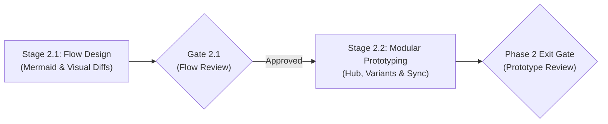
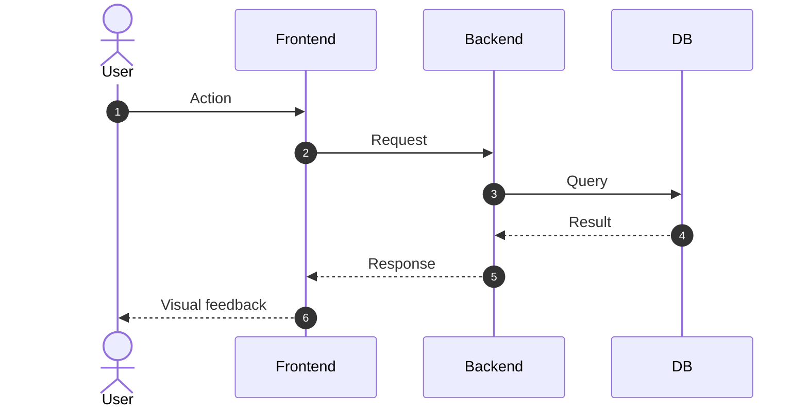
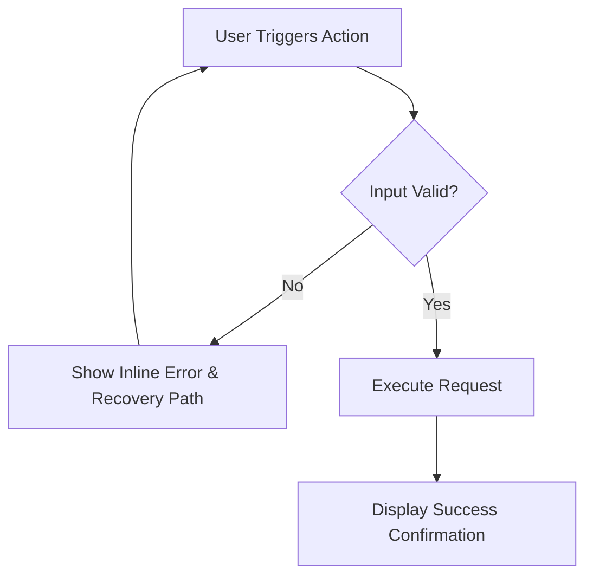
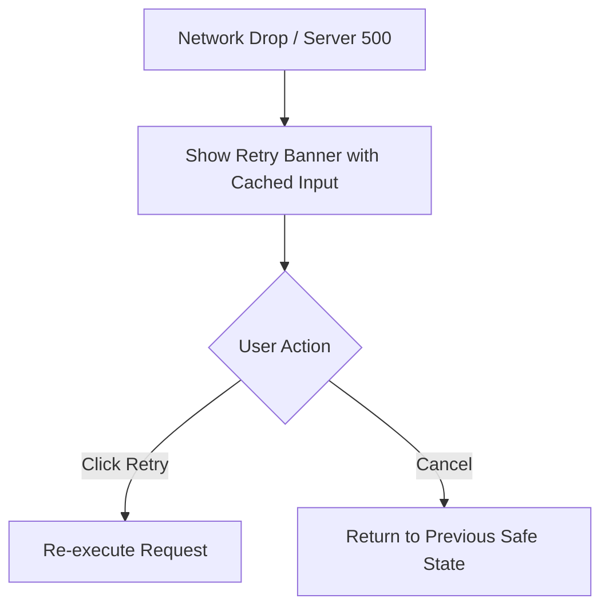

# Phase 2 — Lifecycle Design

## 1. Purpose

> **Core Mental Model:** Visualize the journey. Highlight what changes. Validate the experience with modular interactive prototypes before writing code.

Transform confirmed requirements from Phase 1 (`lifecycle/01-discover.md`) into validated visual flows and user experience designs before technical implementation planning begins.

This phase has two sequential stages:

1. **Stage 2.1 — Flow Design:** Understand and visualize how the feature, user journey, or system process works through clear flow diagrams (using Mermaid).
2. **Stage 2.2 — Modular Prototyping:** For user-facing features, create lightweight, modular HTML prototypes to test UX alternatives, interaction states, and interface behavior.

### UI vs. Non-UI / Backend Path

- **User-Facing / UI Changes:** Both Stage 2.1 (Flow Design) and Stage 2.2 (Prototyping) are mandatory. Stage 2.1 models user journeys, decision branches, and transitions; Stage 2.2 models interactive UI screens, states, and controls in modular HTML prototypes.
- **Non-UI / Backend / API / Architecture Changes:** Stage 2.1 is mandatory and focuses on system architecture, API sequence diagrams, data flows, and state machines. Stage 2.2 (Prototyping) is **explicitly skipped / marked N/A**, and the phase proceeds directly to Phase 3 — Plan once Stage 2.1 flows are approved.

---

## 2. Guiding Principles

- **Understand Before Designing:** Ground every flow and prototype directly in the confirmed requirements from `lifecycle/01-discover.md`. Do not invent business rules or silently resolve product ambiguities.
- **Zero Dead-Ends Law:** Every failure, validation, or error branch in flowcharts must loop back to a recovery action or explicit exit. An orphaned error box terminating in a dead end is an invalid flow.
- **Flow & State Treeing:** Tree flows systematically: Primary Happy Path (Trunk) $\to$ Alternate Scenarios (Branches) $\to$ Edge & Error Recovery Loops (Leaves).
- **Visualize Before Prototyping:** Model and validate flow diagrams before writing HTML prototype code.
- **Highlight What Changes:** For modifications to existing systems, distinguish current behavior from proposed behavior using side-by-side visual diffs or concise change delta tables.
- **Always Create 3 Distinct Options (Pick One or Mix & Merge):** For every UI feature, create **3 structurally distinct prototype variants** (`Option A`, `Option B`, `Option C`) in `lifecycle/prototype/<feature>/` linked from `lifecycle/02-prototype.html`. Cosmetic or color-only tweaks do not count as distinct options. After reviewing all 3, the user can either pick one option or **mix and merge** parts from multiple options into the final approved design.
- **Prevent "God-File" Prototypes:** Never create monolithic single-file prototypes for multi-feature or multi-variant projects. Use a central Prototype Hub (`lifecycle/02-prototype.html`) linking to focused, self-contained option files in `lifecycle/prototype/<feature>/`. Prototypes are temporary validation artifacts—prioritize realistic interaction and modularity over arbitrary line-count limits.
- **Interactive State Toggling:** Every prototype option must feature a sticky top state-switcher bar allowing instant toggling between key interactive states (`Default`, `Empty`, `Loading`, `Error`, `Edge / Restricted`).
- **Self-Contained & Zero-Build:** Prototypes must open directly in any browser with zero build steps, bundlers, or local servers. Embed styles, mock data, and minimal vanilla JS directly in each file.
- **Design System Primitive Alignment (Anti-Translation Reflex):** Prototypes are HTML models—not production code. Do not write complex custom CSS or obsess over pixel perfection. Align HTML structures conceptually with the target project's canonical design system primitives (cards, buttons, dialogs, toasts, spacing tokens, semantic theme roles). In Phase 4 Build, production code must NEVER translate raw HTML/CSS primitives 1:1 into ad-hoc framework widgets (e.g. manual `Container` with arbitrary gradients and raw numeric paddings); it must bind directly to canonical design system components and tokens.
- **Synchronize Discoveries Upstream — Design is a Validator, Not a Decision Record:** `02-design.md` is a visual validation artifact, not a requirements or decision document. Any gap, missing requirement, or unhandled edge case uncovered during flow modeling or prototyping must be pushed back to `lifecycle/01-discover.md` immediately:
  - **Missing Feature Item (`F-N.x`)** → add it under the relevant `### F-N` feature in `01-discover.md` and confirm with the user
  - **New consequential decision** → record it as a `DEC-N` entry in `## 4. Key Decisions & Rationale` in `01-discover.md` — not in `02-design.md`
  - **New open assumption** → add it as `ASM-N` under `**Open Assumptions:**` in `## 0. Research Summary` of `01-discover.md`
  - If Plan is already approved when a gap is found, follow the Mid-Flight Scope Change rule in the lifecycle orchestrator: affected tasks return to `In Progress` before Design can be re-approved.
  `02-design.md` records only: visual flows, prototype file references, and which prototype option was selected per screen (and why the other was rejected). Nothing else.
- **Single Live Document (`lifecycle/02-design.md`):** All flow diagrams, prototype references, and UX decisions live in `lifecycle/02-design.md`.
- **Friction Logging (`lifecycle/refine.md`):** Whenever a Mermaid syntax limitation forces a workaround, a prototyping constraint causes a design compromise, a skill instruction is unclear, or any friction arises that would recur on the next project — immediately append an entry to `lifecycle/refine.md`. Do not wait until phase exit.
- **Strict Phase Boundaries (Negative Constraints):**
  - **No Production Code:** Writing or modifying application source code and running test suites belongs to Phase 4 — Build. Never treat prototype HTML/JS code as production code.
  - **No Technical Architecture or Slices:** Database schemas, API endpoints, file modifications, and task breakdowns belong to Phase 3 — Plan.
  - **No Implementation Task Breakdown:** Estimating engineering effort or sequencing developer tasks belongs to Phase 3 — Plan.
  - **No Unilateral Scope Changes:** Never redefine business goals or expand scope independently; always sync discoveries back to `lifecycle/01-discover.md`.

---

## 3. Responsibilities & Sequence

Phase 2 progresses through two clean sub-stages with explicit human approval gates:



---

### 3.1 Stage 2.1 — Flow Design

**Objective:** Map confirmed requirements into clear, unambiguous visual flows representing happy paths, alternative branches, and error recovery loops.

1. **Review Confirmed Requirements & Trace Seams:**
   - Read `lifecycle/01-discover.md` to understand target features, scope boundaries, and core decisions.
   - Trace caller ripples using read-only codebase searches (`grep`, routes, component tree) to understand existing workflows intersecting the change.
2. **Model Flows via Flow Treeing (Trunk to Leaves):**
   - **Level 1 (Trunk — Happy Path):** Author Mermaid flowcharts or sequence diagrams representing the primary journey from user entry to successful completion.
   - **Level 2 (Branches — Scenarios):** Model user decision forks, alternative pathways, role permissions, and conditional sub-flows.
   - **Level 3 (Leaves — Recovery & Edges):** Model edge conditions, timeout branches, and error recovery loops, strictly enforcing the **Zero Dead-Ends Law**.
   - **Feature-Driven Flow Modeling:** Group visual workflows directly by Target Feature names from Discover, ensuring 1:1 traceability from requirement to visual execution.
3. **Mermaid Diagram Robustness & Syntax Rules:**
   - Always quote node labels containing special characters, brackets, or parentheses (e.g. `id["Action (Details)"]`).
   - Use only supported diagram types: `flowchart TD`, `flowchart LR`, `sequenceDiagram`, and `stateDiagram-v2`.
   - For sequence diagrams, use `autonumber` and clear participant labels; quote participant labels or aliases containing slashes, hyphens, or parentheses.
   - **No Parentheses in Edge Labels:** Avoid parentheses in flowchart edge labels (e.g. use hyphens or clean phrases `|No - Option A|` instead of `|No (Option A)|`) because Mermaid grammar breaks on unescaped parentheses inside `|...|` delimiters.
   - **No Nested `alt` in Sequence Diagrams:** Prohibit nested `alt` blocks (use sequential `opt` blocks or flat sequential checks); standard Mermaid sequence grammar strictly forbids nested `alt` and crashes markdown renderers.
   - **Flush Column-0 Fenced Code Blocks:** Never nest Mermaid code blocks inside bullet points; place them under level-3 headings (`### F-N — [Action / Flow Name]` or `### Shared — Error Recovery Flow`) flush at column 0 to prevent markdown rendering errors.
4. **Enforce Zero Dead-Ends & Sync Gaps Upstream:**
   - Verify that every error branch, validation failure, and timeout loops back to an actionable user recovery step or a safe exit. Never leave an orphaned error box.
   - For modifications to existing systems, distinguish current behavior from proposed behavior using side-by-side visual diffs or concise change delta tables.
   - If flow modeling reveals a missing `F-N.x` feature item or an unresolved decision, push it back to `lifecycle/01-discover.md` before the Gate 2.1 approval request.
   - Document flows in `lifecycle/02-design.md` under `## 2. Workflows`.
5. **Gate 2.1 Approval Protocol:**
   - **Pre-Gate Reconciliation Audit (Mandatory):** Before marking Stage 2.1 as `In Review`, scan every node, action, branch, and state in the completed flow diagrams. For each functionality found, verify it maps to an `F-N.x` item in `lifecycle/01-discover.md`. For any functionality present in the flows but absent from `01-discover.md`, surface it to the user using this format before requesting approval:

     ```
     🔍 Found in Flow, Not in Discover: <Short Title>
     - **What it is:** [What this functionality does, in plain English]
     - **Where it appears:** [Which flow diagram / which step]
     - **Not found in:** [F-N — Feature Name]

     What should we do with this?
     - **A — Add to Discover:** Add it as an `F-N.x` item under `### F-N` and confirm scope
     - **B — Remove from Flow:** Remove it from the diagram — it was added by mistake
     - **C — Defer:** Note it as a Deferred item in `01-discover.md` and remove it from this flow
     ```

     Wait for the user's explicit decision on every unlisted item before proceeding. Never request Gate 2.1 approval while any unlisted functionality remains unresolved.
   - **Forward Coverage Check (Discover → Flow):** Also verify that every `F-N.x` item in `lifecycle/01-discover.md` appears in the flows. For any item missing from the flows, surface it before Gate 2.1:

     ```
     🔍 Missing from Flow (Found in Discover): <Short Title>
     - **From Feature:** [F-N — Feature Name]
     - **Feature item:** [F-N.x — exact item text from 01-discover.md]

     What should we do with this?
     - **A — Add to Flow:** Include it in the workflow diagrams now
     - **B — Move to Deferred:** Move it to Deferred in `01-discover.md`
     - **C — Remove from Discover:** Remove it from `01-discover.md` as Out of Scope
     ```
   - Update row `Stage 2.1 — Flow Design` to `In Review` in `lifecycle/00-status.md`.
   - Stop calling tools immediately.
   - Follow the **Phase 0 Chat Approval Protocol** to present visual workflows in chat and ask for explicit approval before writing prototype code.
   - **Gate Outcome:**
     - *If Approved:* Mark `Stage 2.1 — Flow Design` as `Done` in `00-status.md`. For UI tasks, set `Stage 2.2 — Interactive Prototype` to `In Progress` and advance to Stage 2.2. For pure backend/non-UI tasks, mark `Stage 2.2` as `Skipped (N/A)` and advance directly to Phase 3 — Plan.
     - *If Changes Requested:* Keep `Stage 2.1` as `In Progress`, revise `02-design.md`, and re-present.

---

### 3.2 Stage 2.2 — Modular Prototyping & Upstream Sync

**Objective:** Translate approved flows into interactive browser prototypes to validate UX decisions, screen layouts, and state transitions before planning technical tasks.

> **Applicability Note:** Pure non-UI / backend changes explicitly skip this stage. Mark Stage 2.2 as `Skipped (N/A)` in `lifecycle/00-status.md` and advance directly to Phase 3 — Plan.

1. **Create 3 Distinct Prototype Variants (Option A, B, C):**
   - Build **3 genuinely different interaction models** for each UI feature (e.g. Option A: inline table editing, Option B: slide-over drawer, Option C: step-by-step modal wizard).
   - Let the user either pick one option or mix and merge parts from different options into the final design.
2. **Directory Structure (Modular Hub Architecture):**
   ```text
   lifecycle/
   ├── 02-design.md            # Primary design documentation and workflows
   ├── 02-prototype.html       # Central Hub: feature index, option trade-offs, decision cards
   └── prototype/
       └── <feature-slug>/     # e.g., auth, dashboard, billing
           ├── option-a.html   # Self-contained variant A
           ├── option-b.html   # Self-contained variant B
           └── option-c.html   # Self-contained variant C
   ```
3. **Build Self-Contained Prototype Options:**
   - **Focused Scope:** Keep each option file focused on the specific screen or workflow being tested. It is a throwaway validation artifact—prioritize realistic interaction over line count limits.
   - **Self-Contained & Zero-Build:** Include inline `<style>` and minimal vanilla JS inside each HTML file. Avoid npm/build tooling (modern CSS or Tailwind via CDN is acceptable).
   - **Default Light Theme:** Always use a clean light theme matching `.agents/rules/design_system.md` if present (page `#F5F5F5`, cards `#FFFFFF`, borders `#E2DFD8`, hover `#F0EEE9`, primary `#1B4FD8`, dark text `#212121`), or neutral light surfaces (`#F5F5F5` / `#FFFFFF` / `#E2DFD8`) if no design system rule file exists.
   - **No Native Browser Popups:** Never use `window.alert()`, `window.confirm()`, or `window.prompt()`. Always build real HTML modal dialogs and toast banners so reviewers can check exact titles, warnings, and button labels.
   - **Prototype State Treeing (Sticky State-Switcher Bar):** Include a sticky top header bar to toggle between states instantly:
     - `Default`: Standard loaded state with realistic mock data.
     - `Empty`: Zero-data state with onboarding cues.
     - `Loading`: Skeletons, spinners, or disabled interaction states.
     - `Error / Validation`: Field-level errors, banner alerts, retry prompts.
     - `Edge / Permissions`: Restricted view, read-only state, or modal confirmation.
   - **Async Communication Drawer:** For multi-step async flows (e.g. email verification links, magic links, SMS OTPs), embed a simulated collapsible drawer or modal in the prototype so reviewers can inspect payloads and click links directly.
   - **Design System Alignment (Read Project Rules First):** Always read `.agents/rules/design_system.md` (or the project's UI rule file) *before* writing prototype HTML so colors, spacing, radii, icon sizes, and component names stay automatically in sync with production rules:
     - Mirror the project's canonical cards, buttons, dialogs, toasts, and empty/loading/error views in clean Tailwind/HTML.
     - Use the project's spacing and icon scale (`4 / 8 / 16px` spacing, `20 / 40px` icons) rather than arbitrary pixel values.
     - *Plain-Language Copy (5th-Grade Standard):* Write all prototype dialog titles, button labels, toasts, and notices in simple, everyday English. Ban technical and corporate jargon.
     - *No Over-Engineering:* Never try to build pixel-perfect framework look-alikes — aligning on component primitives, spacing, and plain-language copy is enough.
4. **Assemble the Central Prototype Hub (`lifecycle/02-prototype.html`):**
   - Provide an index of all 3 prototype options organized by feature.
   - Include a **"Needs Decision"** banner highlighting the specific trade-offs between Option A, B, and C, and note that parts can be mixed and merged.
   - Embed lightweight Mermaid sub-flow diagrams where visual process context clarifies the screen being viewed.
5. **Synchronize Gaps Upstream & Record Prototype Decision:**
   - For every gap, missing `F-N.x` item, or new decision uncovered during prototyping: push it back to `lifecycle/01-discover.md` (`### F-N`, `DEC-N`, or `ASM-N` as appropriate). Never record decisions in `02-design.md`.
   - At Gate 2.2 (`In Review`), list `[02-prototype.html](02-prototype.html)` under `## 1. UI Prototypes` with status `Pending Selection (Options A / B / C ready for review)`. Once the user selects an option (or mixes and merges parts), update that line with the chosen option and a 1-sentence rationale for why rejected parts were not used before marking Stage 2.2 `Done`.
6. **Pre-Exit Reconciliation Audit — Prototype (Mandatory):**
   Before requesting Phase 2 exit approval, run a two-way check:
   - **Prototype → Discover:** Scan every screen, control, input, action, state, and navigation path in the finalized prototype. Surface any element absent from `01-discover.md` using `🔍 Found in Prototype, Not in Discover`. If the user chooses **Add to Discover**, treat it as a new requirement using `lifecycle-discover` (ask any `ASM-N` questions one by one and document all 5 edge-case lenses in `01-discover.md`) before finalizing Design.
   - **Discover → Prototype:** Check every `F-N.x` item in `lifecycle/01-discover.md`. Surface any item missing from the prototype using `🔍 Missing from Prototype (Found in Discover)` (Add to Prototype / Move to Deferred / Remove from Discover).
   Only after every two-way mismatch is resolved may the Phase 2 exit gate be requested.

---

## 4. Exit Gate & Completion Criteria

Phase 2 can transition to Phase 3 — Plan only when the completion checklist is fully satisfied and the user grants explicit approval in chat.

### Completion Checklist (Pre-Flight Gate)

Before requesting user approval, verify that:
- **Requirement Traceability:** Visual flows directly reflect all confirmed requirements from `lifecycle/01-discover.md`.
- **Zero Dead-Ends Verified:** Every error, validation, and timeout branch loops back to an actionable user recovery step or safe exit.
- **Change Delta Clarified:** For modifications to existing systems, current vs. proposed behavior is clearly distinguished via visual diffs or delta tables.
- **Mermaid Syntax Validated:** All diagrams use supported types (`flowchart`, `sequenceDiagram`, `stateDiagram-v2`) with quoted labels for special characters, zero parentheses in edge labels, and zero nested `alt` blocks.
- **3 Prototype Options & Hub Assembled:** (UI only) Prototypes include 3 distinct variants (`Option A`, `Option B`, `Option C`) in `prototype/<feature>/` linked from `02-prototype.html`, using a clean light theme and HTML modal dialogs (zero `window.alert` / `window.confirm`).
- **State-Switcher Bar Functional:** (UI only) Sticky bar allows instant toggling between Default, Empty, Loading, Error, and Edge states.
- **Async Inspection Drawer Included:** (UI only) Simulated drawer allows testing email/magic link payloads without external mail servers.
- **Non-UI Explicitly Skipped:** For pure backend tasks, prototyping is explicitly marked `Skipped (N/A)` in `lifecycle/00-status.md`.
- **Feature Item Coverage (Two-Directional):** Every `F-N.x` item from `01-discover.md` is represented by at least one flow or prototype screen. Conversely, every interactive element in the prototype traces back to an `F-N.x` item — no phantom UI elements added during Design without first updating `01-discover.md`.
- **Reconciliation Audit Completed:** Both pre-gate audits have been run — one after flows (Gate 2.1) and one after prototypes (Phase 2 exit). Every functionality found in flows or prototypes but absent from `01-discover.md` was surfaced to the user and explicitly resolved (Added to Discover / Removed from Design / Deferred). Zero unresolved unlisted elements remain.
- **Gaps Synced to Discover:** Any missing requirement, unhandled edge case, new decision, or new assumption found during flow modeling or prototyping has been pushed back to `lifecycle/01-discover.md` (`### F-N`, `DEC-N`, or `ASM-N`). Zero decisions or requirements remain recorded only in `02-design.md`.
- **Upstream Sync Complete:** `lifecycle/01-discover.md` reflects the full current understanding after Design — it is the single source of truth for requirements and decisions.

### Requesting User Approval (Phase 0 Protocol)

1. Update `Stage 2.2 — Interactive Prototype` (or Phase 2 overall) to `In Review` in `lifecycle/00-status.md`.
2. In chat, output a concise 1–2 sentence summary linking `[02-design.md](02-design.md)` (and `[02-prototype.html](02-prototype.html)` if UI) and ask for explicit approval to advance to Phase 3 — Plan.
3. Stop calling tools immediately and wait for the user's explicit response.

### Gate Outcomes

- **Approved:** Mark Phase 2 as `Done` in `lifecycle/00-status.md`, load `lifecycle-plan`, and advance to Phase 3 — Plan.
- **Changes Requested:** Mark active stage as `In Progress`, revise `02-design.md` or prototype files, re-verify, and present again.
- **Blocked:** An unresolved design question, architectural constraint, or requirement conflict blocks progress. Return to Phase 1 — Discover or request clarification.

---

## 5. Phase Output

The primary deliverable is `lifecycle/02-design.md`, supported by `lifecycle/02-prototype.html` and `lifecycle/prototype/` for UI features.

### Recommended Structure for `lifecycle/02-design.md`

```markdown
# Design: [Requirement / Feature Name]

## 1. UI Prototypes

- **Prototype Hub:** [02-prototype.html](02-prototype.html) *(or "Skipped (N/A for Non-UI)")*
- **[Screen 1]:** `Pending Selection (Options A / B / C ready for review)` *(update after Gate 2.2 to: `[Option B](prototype/<feature>/option-b.html) selected` or `Mixed Option A + B` — 1 sentence on why rejected options/parts were not used)*

## 2. Workflows

### F1 — [Action / Flow Name]



### F2 — [Action / Flow Name]



### Shared — Error Recovery Flow


```
