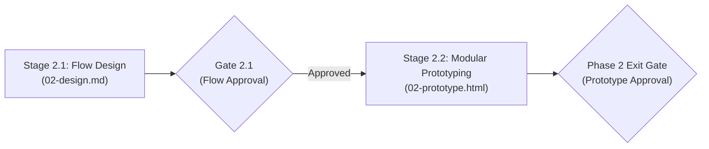
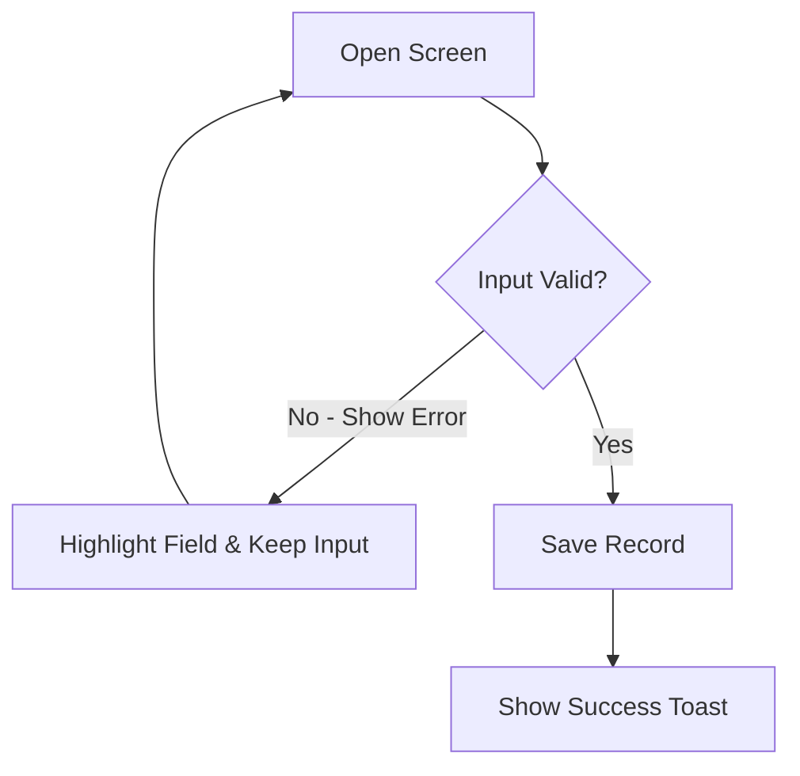
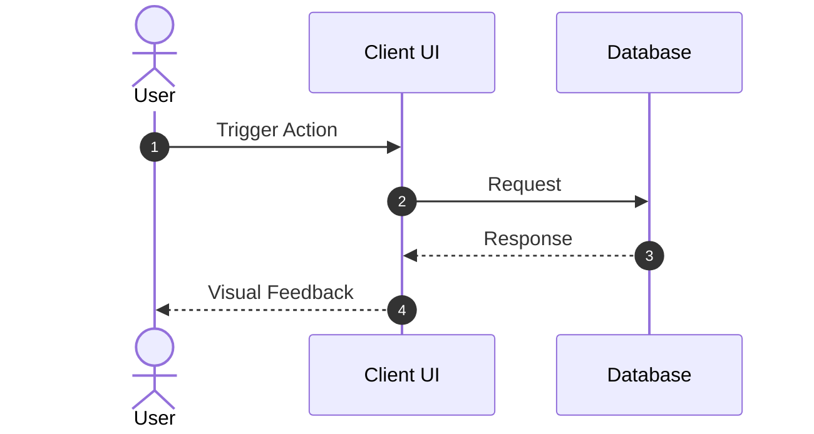
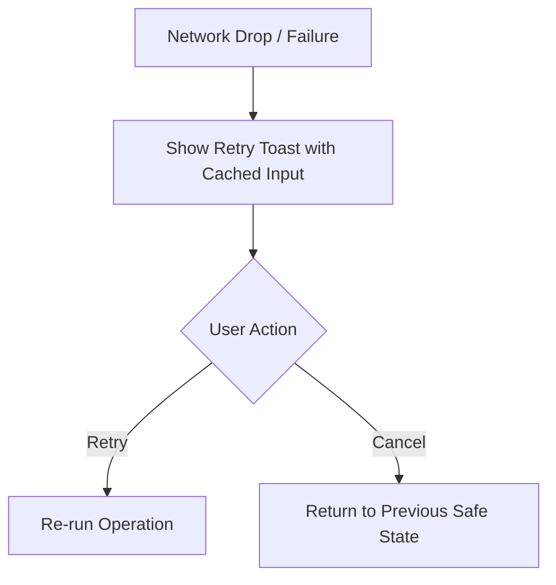

# Phase 2 — Lifecycle Design

## 1. Purpose

> **Core Mental Model:** Visualize every `F-N` screen and flow. Catch dead-ends early. Validate the UX with lightweight interactive prototypes before writing a single line of production code.

Phase 2 runs in two sequential stages with explicit human gates:
- **Stage 2.1 — Flow Design:** Model user journeys, decision branches, and error recovery loops in `lifecycle/02-design.md` (mandatory for all tasks).
- **Stage 2.2 — Modular Prototyping:** Build zero-build interactive HTML prototypes in `lifecycle/prototype/` linked from `lifecycle/02-prototype.html` (**UI tasks only** — mark `Skipped (N/A)` in `00-status.md` for pure backend/API tasks and advance directly to Phase 3 — Plan).

---

## 2. Core Rules

- **1:1 `F-N` Correlation With Discover:** Every `### F-N — [Screen/Flow Name]` in `lifecycle/01-discover.md` maps 1:1 to a prototype entry in `## 1. UI Prototypes` and a workflow diagram in `## 2. Workflows` using the exact same `F-N` heading.
- **Pause on Exploratory or Structural Questions:** Never treat a user's exploratory question (e.g. *"Do you think this should be two separate stages?"*) as implicit phase approval. Pause progression, unpack each proposed stage or mode, sync back to `01-discover.md`, and obtain explicit alignment before advancing.
- **Zero Dead-Ends & Scannable Diagrams:** Every error, validation, or timeout branch must loop back to a recovery action or safe exit. Keep each Mermaid diagram focused on one `F-N` screen/flow (~12–18 nodes max; split sub-flows if larger) and let the diagram speak for itself (no repetitive `Trunk / Branches / Leaves` prose preambles).
- **Mandatory 3 Distinct Variants Per UI `F-N` Feature (No Shortcuts):** For **every** UI `F-N` feature in `01-discover.md`, create a dedicated `lifecycle/prototype/<f-n-slug>/` folder containing **3 structurally distinct variants** (`option-a.html`, `option-b.html`, `option-c.html` — cosmetic/color-only tweaks do not count) so the user can pick one or mix and merge parts. Never skip any UI `F-N` feature, and never cram multiple `F-N` features into a single prototype file.
- **Zero-Build & Design-System First:** Always read `.agents/rules/design_system.md` (where colors, typography, spacing, radii, and canonical components are defined) *before* writing any prototype HTML; only default to a clean neutral light theme if no design system file exists. Prototypes must open directly in any browser with zero build tools, include a sticky state-switcher bar (`Default`, `Empty`, `Loading`, `Error`, `Edge`), and never use native `window.alert`/`confirm`/`prompt`.
- **Semantic UI Labels (Anti-Translation Guardrail):** Label prototype sections conceptually (`App Bar`, `End Drawer`, `Modal Dialog`, `Empty / Loading / Error View`) rather than obsessing over custom CSS, so Phase 4 Build maps 1:1 to canonical design system components instead of translating raw HTML divs.
- **Design Validates; Discover Owns Decisions (`01-discover.md`):** Never record new requirements or decisions only in `02-design.md`. Push every discovered gap upstream immediately: missing feature item → `### F-N` (`F-N.x`), new trade-off decision → `## 4` (`DEC-N`), new open question → `## 6` (`**Open Questions (ASM-N):**`). If Plan was already approved, follow Mid-Flight Scope Realignment in `lifecycle`.
- **Strict Phase Boundaries & Friction Logging:** No production code, no database schemas/API specs, and no task breakdowns (Phases 3–4). Immediately append any Mermaid limitation, prototyping constraint, or skill friction to `lifecycle/refine.md`.

---

## 3. Execution Sequence



### 3.1 Stage 2.1 — Flow Design

1. **Read Discover & Trace Seams:** Read `lifecycle/01-discover.md` (`F-N` headings, `F-N.x` items, `F-N-E1..E5` edge cases) and trace intersecting routes/callers via read-only `grep`.
2. **Model One Focused Mermaid Diagram Per `F-N` (`## 2. Workflows`):**
   - Cover happy path, decision branches, and error recovery loops (Zero Dead-Ends).
   - For modifications to existing flows, include a concise before/after delta table or side-by-side diff.
   - **Mermaid Syntax Safety:**
     - Use only `flowchart TD`, `flowchart LR`, `sequenceDiagram` (with `autonumber`), or `stateDiagram-v2`.
     - Quote node labels containing special characters, brackets, or parentheses (`id["Action (Details)"]`).
     - Never put parentheses inside edge labels (`|No - Retry|` not `|No (Retry)|`).
     - Never nest `alt` blocks in sequence diagrams (use sequential `opt` blocks).
     - Place fenced Mermaid blocks flush at column 0 under `### F-N` headings (never inside bullets).
3. **Two-Way Reconciliation Audit (Mandatory Before Gate 2.1):**
   - Scan every flow against `01-discover.md` in both directions:
     - *In Flow, Not in Discover* → ask user: **A — Add to Discover (`F-N.x`)**, **B — Remove from Flow**, or **C — Defer**.
     - *In Discover, Missing from Flow* → ask user: **A — Add to Flow**, **B — Move to Deferred**, or **C — Remove as Out of Scope**.
   - Resolve every mismatch before requesting Gate 2.1 approval.
4. **Gate 2.1 Approval:** Set `Stage 2.1 — Flow Design` to `In Review` in `lifecycle/00-status.md`, link `[02-design.md](02-design.md)` in chat (1–2 sentences), and stop for explicit approval. Once approved, mark Stage 2.1 `Done` and advance to Stage 2.2 (or mark Stage 2.2 `Skipped (N/A)` for pure backend tasks and advance to Phase 3 — Plan).

### 3.2 Stage 2.2 — Modular Prototyping & Upstream Sync *(UI Only)*

1. **Directory Structure (One Folder With 3 Variants Per UI `F-N` Feature):**
   ```text
   lifecycle/
   ├── 02-design.md
   ├── 02-prototype.html           # Central Hub: every UI F-N indexed with trade-offs & launch links
   └── prototype/
       ├── <f1-slug>/              # e.g. user-list/ (option-a.html, option-b.html, option-c.html)
       └── <f2-slug>/              # e.g. user-detail/ (option-a.html, option-b.html, option-c.html)
   ```
2. **Build Self-Contained Prototype Files (3 Variants Per UI `F-N`):**
   - **Read `.agents/rules/design_system.md` first** (mandatory if present) so every color, spacing token, radius, icon size, and component pattern matches the design system.
   - Include inline `<style>` and vanilla JS (Tailwind CDN optional; zero build steps).
   - Add a sticky top state-switcher bar (`Default`, `Empty`, `Loading`, `Error`, `Edge / Permissions`) and real HTML modals/toasts (never `window.alert` / `window.confirm`).
   - For multi-step async flows (emails, OTPs, magic links), include a collapsible simulated drawer to inspect payloads.
   - Annotate major regions with semantic comments (`<!-- App Bar -->`, `<!-- End Drawer -->`, `<!-- Modal Dialog -->`) and use plain 5th-grade English copy throughout.
3. **Assemble Prototype Hub (`lifecycle/02-prototype.html`):**
   - List every `F-N` screen with launch links to its variant(s) and a short **"Needs Decision"** note highlighting key trade-offs (noting parts can be mixed and merged).
4. **Two-Way Reconciliation Audit (Prototype ↔ Discover):**
   - Verify every control, input, and state in the finalized prototype maps to an `F-N.x` item in `01-discover.md` and vice versa. Resolve any mismatch with the user (pushing confirmed additions back to `01-discover.md`) before requesting Phase 2 exit approval.
5. **Record Selection in `02-design.md`:**
   - At Gate 2.2 (`In Review`), list each `F-N` screen under `## 1. UI Prototypes` as `Pending Selection`. After user selection, update each line with the chosen option (or mix-and-merge summary) and a 1-sentence reason for rejecting the other option(s).

---

## 4. Exit Gate & Completion Criteria

### Pre-Flight Checklist

Before requesting Phase 2 exit approval, verify:
- **1:1 `F-N` Traceability:** Every `F-N` from `01-discover.md` has a matching workflow in `02-design.md` and (if UI) a prototype link in `02-prototype.html`.
- **Zero Dead-Ends & Clean Mermaid:** Every error/validation path recovers cleanly; all diagrams use valid syntax and stay focused (~12–18 nodes).
- **Prototypes Complete (or Marked N/A):** Every UI `F-N` feature has its own `prototype/<f-n-slug>/` folder with 3 distinct zero-build variants (`option-a/b/c.html`) styled from `.agents/rules/design_system.md` (if present), with state-switcher bars, HTML modals, semantic region comments, and plain-English copy (pure backend tasks marked `Skipped (N/A)`).
- **Two-Way Reconciliation Clean:** Zero unresolved mismatches between `01-discover.md`, `02-design.md`, and prototypes; all new requirements or decisions synced upstream to `01-discover.md`.

### Requesting User Approval (Phase 0 Protocol)

1. Set `Stage 2.2 — Interactive Prototype` to `In Review` in `lifecycle/00-status.md`.
2. Output a concise 1–2 sentence summary linking `[02-design.md](02-design.md)` (and `[02-prototype.html](02-prototype.html)` if UI) and ask for explicit approval to advance to Phase 3 — Plan.
3. Stop calling tools and wait for the user's response (`Approved` → mark Phase 2 `Done`, load `lifecycle-plan`; `Changes Requested` → return to `In Progress`; `Blocked` → mark `Blocked`).

---

## 5. Output Template (`lifecycle/02-design.md`)

```markdown
# Design: [Requirement / Feature Name]

## 1. UI Prototypes

- **Prototype Hub:** [02-prototype.html](02-prototype.html) *(or `Skipped — N/A for Non-UI`)*
- **F1 — [Screen 1 Name]:** `Pending Selection` *(after Gate 2.2: `[Option B](prototype/<slug>/option-b.html)` — 1-sentence reason why others were rejected)*
- **F2 — [Screen 2 Name]:** `Pending Selection`

## 2. Workflows

### F1 — [Screen or Flow Name]



### F2 — [Screen or Flow Name]



### Shared — Error Recovery


```
