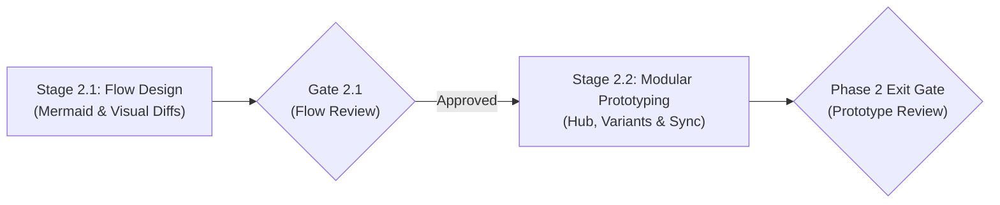
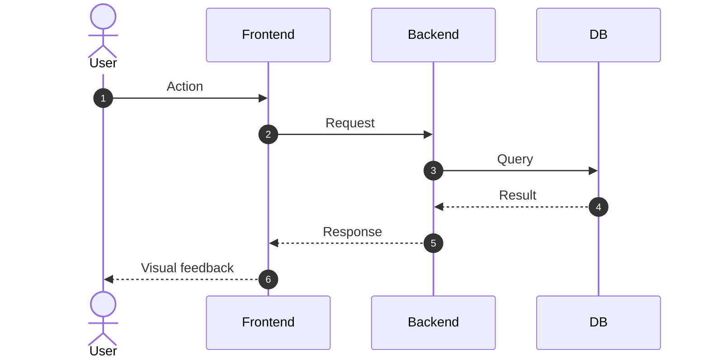
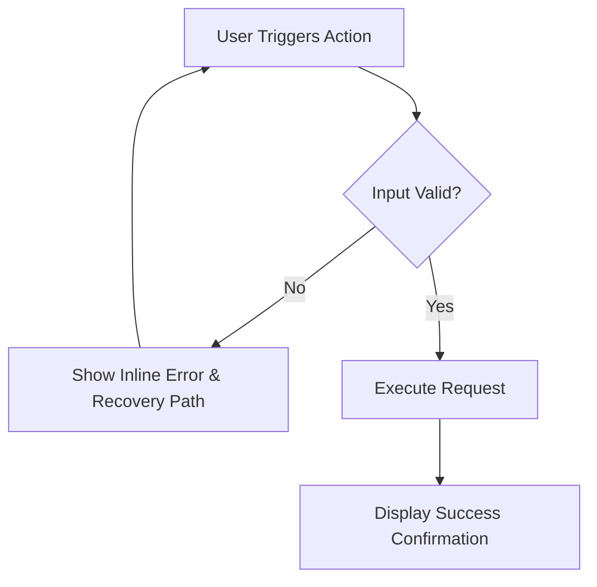
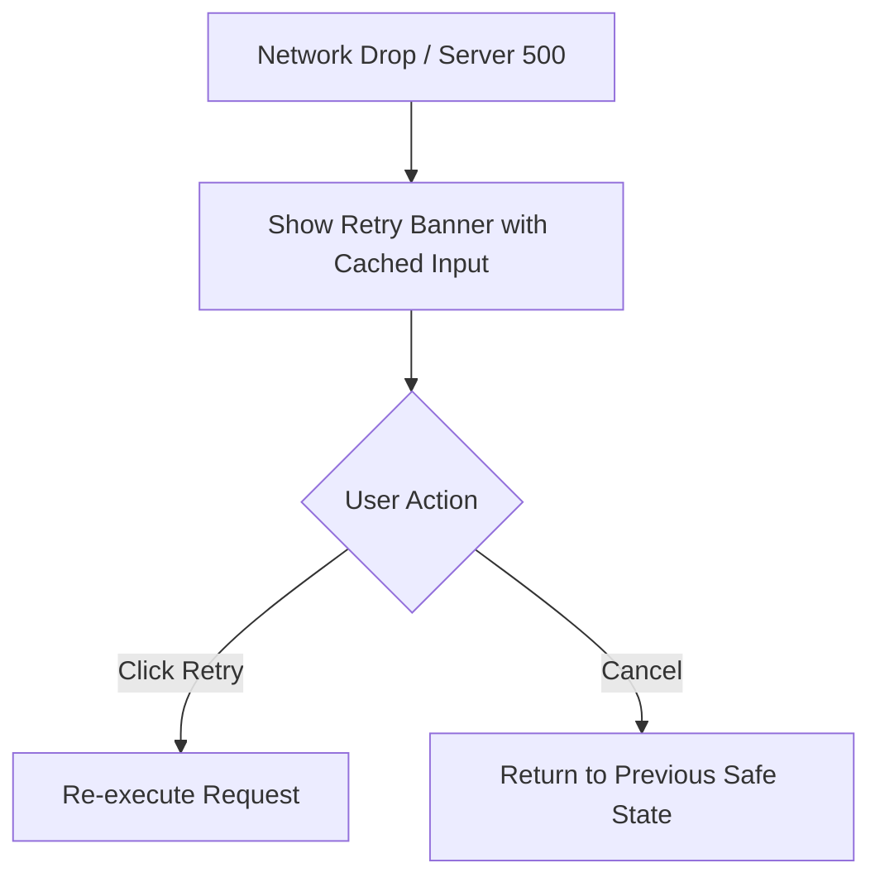

# Phase 2 — Lifecycle Design

## 1. Purpose

> **Core Mental Model:** Visualize the journey. Highlight what changes. Validate the experience with modular interactive prototypes before writing code.

Transform confirmed requirements from Phase 1 (`lifecycle/01-discover.md`) into validated visual flows and user experience designs before technical implementation planning begins.

This phase has two sequential stages:

1. **Stage 2.1 — Flow Design:** Understand and visualize how the feature, user journey, or system process works through clear flow diagrams (using Mermaid).
2. **Stage 2.2 — Modular Prototyping:** For user-facing features, create lightweight, modular HTML prototypes to test UX alternatives, interaction states, and interface behavior.

### UI vs. Non-UI / Backend Path

- **User-Facing / UI Changes:** Both Stage 2.1 (Flow Design) and Stage 2.2 (Prototyping) are mandatory. Stage 2.1 models user journeys, decision branches, and transitions; Stage 2.2 models interactive UI screens, states, and controls in modular HTML prototypes.
- **Non-UI / Backend / API / Architecture Changes:** Stage 2.1 is mandatory and focuses on system architecture, API sequence diagrams, data flows, and state machines. Stage 2.2 (Prototyping) is **explicitly skipped / marked N/A**, and the phase proceeds directly to Phase 3 — Plan once Stage 2.1 flows are approved.

---

## 2. Guiding Principles

- **Understand Before Designing:** Ground every flow and prototype directly in the confirmed requirements from `lifecycle/01-discover.md`. Do not invent business rules or silently resolve product ambiguities.
- **Zero Dead-Ends Law:** Every failure, validation, or error branch in flowcharts must loop back to a recovery action or explicit exit. An orphaned error box terminating in a dead end is an invalid flow.
- **Flow & State Treeing:** Tree flows systematically: Primary Happy Path (Trunk) $\to$ Alternate Scenarios (Branches) $\to$ Edge & Error Recovery Loops (Leaves).
- **Visualize Before Prototyping:** Model and validate flow diagrams before writing HTML prototype code.
- **Highlight What Changes:** For modifications to existing systems, distinguish current behavior from proposed behavior using side-by-side visual diffs or concise change delta tables.
- **1-Hypothesis Prototype Fork:** Every comparative option (Option A vs. Option B) must test a singular, explicit UX hypothesis (e.g., Speed of Entry vs. Guided Error Prevention). Cosmetic or color variations do not count as distinct options.
- **Scale Exploration to Uncertainty:**
  - *Focused (1 option):* Minor adjustments or flows following established design conventions.
  - *Comparative (2 options):* Meaningful UX decisions with two viable interaction models.
  - *Broad (up to 3 options):* Complex or novel workflows with structurally distinct approaches.
- **Prevent "God-File" Prototypes:** Never create monolithic single-file prototypes for multi-feature or multi-variant projects. Use a central Prototype Hub (`lifecycle/02-prototype.html`) linking to focused, self-contained option files in `lifecycle/prototype/<feature>/`. Prototypes are temporary validation artifacts—prioritize realistic interaction and modularity over arbitrary line-count limits.
- **Interactive State Toggling:** Every prototype option must feature a sticky top state-switcher bar allowing instant toggling between key interactive states (`Default`, `Empty`, `Loading`, `Error`, `Edge / Restricted`).
- **Self-Contained & Zero-Build:** Prototypes must open directly in any browser with zero build steps, bundlers, or local servers. Embed styles, mock data, and minimal vanilla JS directly in each file.
- **Design System Primitive Alignment (Keep It Simple):** Prototypes are HTML models—not Flutter code. Do not write complex custom CSS or obsess over pixel perfection. However, HTML structures must mirror the project's design system primitives conceptually (cards, primary/secondary buttons, dialogs, toasts, message views, semantic theme roles, and plain-language copy). Aligning these primitives in HTML allows Phase 4 Build to translate prototypes directly into canonical Flutter components without redesigning the UX.
- **Synchronize Discoveries Upstream:** If prototyping reveals missing requirements, edge cases, or UX simplifications, immediately update `lifecycle/01-discover.md` in place.
- **Single Live Document (`lifecycle/02-design.md`):** All flow diagrams, prototype references, and UX decisions live in `lifecycle/02-design.md`.
- **Strict Phase Boundaries (Negative Constraints):**
  - **No Production Code:** Writing or modifying application source code and running test suites belongs to Phase 4 — Build. Never treat prototype HTML/JS code as production code.
  - **No Technical Architecture or Slices:** Database schemas, API endpoints, file modifications, and task breakdowns belong to Phase 3 — Plan.
  - **No Implementation Task Breakdown:** Estimating engineering effort or sequencing developer tasks belongs to Phase 3 — Plan.
  - **No Unilateral Scope Changes:** Never redefine business goals or expand scope independently; always sync discoveries back to `lifecycle/01-discover.md`.

---

## 3. Responsibilities & Sequence

Phase 2 progresses through two clean sub-stages with explicit human approval gates:



---

### 3.1 Stage 2.1 — Flow Design

**Objective:** Map confirmed requirements into clear, unambiguous visual flows representing happy paths, alternative branches, and error recovery loops.

1. **Review Confirmed Requirements & Trace Seams:**
   - Read `lifecycle/01-discover.md` to understand target features, scope boundaries, and core decisions.
   - Trace caller ripples using read-only codebase searches (`grep`, routes, component tree) to understand existing workflows intersecting the change.
2. **Model Flows via Flow Treeing (Trunk to Leaves):**
   - **Level 1 (Trunk — Happy Path):** Author Mermaid flowcharts or sequence diagrams representing the primary journey from user entry to successful completion.
   - **Level 2 (Branches — Scenarios):** Model user decision forks, alternative pathways, role permissions, and conditional sub-flows.
   - **Level 3 (Leaves — Recovery & Edges):** Model edge conditions, timeout branches, and error recovery loops, strictly enforcing the **Zero Dead-Ends Law**.
   - **Feature-Driven Flow Modeling:** Group visual workflows directly by Target Feature names from Discover, ensuring 1:1 traceability from requirement to visual execution.
3. **Mermaid Diagram Robustness & Syntax Rules:**
   - Always quote node labels containing special characters, brackets, or parentheses (e.g. `id["Action (Details)"]`).
   - Use only supported diagram types: `flowchart TD`, `flowchart LR`, `sequenceDiagram`, and `stateDiagram-v2`.
   - For sequence diagrams, use `autonumber` and clear participant labels; quote participant labels or aliases containing slashes, hyphens, or parentheses.
   - **No Parentheses in Edge Labels:** Avoid parentheses in flowchart edge labels (e.g. use hyphens or clean phrases `|No - Option A|` instead of `|No (Option A)|`) because Mermaid grammar breaks on unescaped parentheses inside `|...|` delimiters.
   - **No Nested `alt` in Sequence Diagrams:** Prohibit nested `alt` blocks (use sequential `opt` blocks or flat sequential checks); standard Mermaid sequence grammar strictly forbids nested `alt` and crashes markdown renderers.
   - **Flush Column-0 Fenced Code Blocks:** Never nest Mermaid code blocks inside bullet points; place them under level-3 headings (`### Workflow X: [Feature Name]`) flush at column 0 to prevent markdown rendering errors.
4. **Enforce Zero Dead-Ends & Highlight What Changes:**
   - Verify that every error branch, validation failure, and timeout loops back to an actionable user recovery step or a safe exit. Never leave an orphaned error box.
   - For modifications to existing systems, distinguish current behavior from proposed behavior using side-by-side visual diffs or concise change delta tables.
   - Document flows in `lifecycle/02-design.md` under `## 2. Visual Workflows & Sequences`.
5. **Gate 2.1 Approval Protocol:**
   - Update row `Stage 2.1 — Flow Design` to `In Review` in `lifecycle/00-status.md`.
   - Stop calling tools immediately.
   - Follow the **Phase 0 Chat Approval Protocol** to present visual workflows in chat and ask for explicit approval before writing prototype code.
   - **Gate Outcome:**
     - *If Approved:* Mark `Stage 2.1 — Flow Design` as `Done` in `00-status.md`. For UI tasks, set `Stage 2.2 — Interactive Prototype` to `In Progress` and advance to Stage 2.2. For pure backend/non-UI tasks, mark `Stage 2.2` as `Skipped (N/A)` and advance directly to Phase 3 — Plan.
     - *If Changes Requested:* Keep `Stage 2.1` as `In Progress`, revise `02-design.md`, and re-present.

---

### 3.2 Stage 2.2 — Modular Prototyping & Upstream Sync

**Objective:** Translate approved flows into interactive browser prototypes to validate UX decisions, screen layouts, and state transitions before planning technical tasks.

> **Applicability Note:** Pure non-UI / backend changes explicitly skip this stage. Mark Stage 2.2 as `Skipped (N/A)` in `lifecycle/00-status.md` and advance directly to Phase 3 — Plan.

1. **Select Exploration Depth & Apply the 1-Hypothesis Fork:**
   - Assess UX uncertainty: Focused (1 option), Comparative (2 options), or Broad (3 options).
   - Ensure each option tests a singular, distinct hypothesis (e.g. Option A: Speed of Entry via in-place table editing vs. Option B: Error Prevention via a dedicated slide-over wizard).
2. **Directory Structure (Modular Hub Architecture):**
   ```text
   lifecycle/
   ├── 02-design.md            # Primary design documentation and decisions
   ├── 02-prototype.html       # Central Hub: feature index, option trade-offs, decision cards
   └── prototype/
       └── <feature-slug>/     # e.g., auth, dashboard, billing
           ├── option-a.html   # Self-contained variant A
           └── option-b.html   # Self-contained variant B
   ```
3. **Build Self-Contained Prototype Options:**
   - **Focused Scope:** Keep each option file focused on the specific screen or workflow being tested. It is a throwaway validation artifact—prioritize realistic interaction over line count limits.
   - **Self-Contained & Zero-Build:** Include inline `<style>` and minimal vanilla JS inside each HTML file. Avoid npm/build tooling (modern CSS or Tailwind via CDN is acceptable).
   - **Prototype State Treeing (Sticky State-Switcher Bar):** Include a sticky top header bar to toggle between states instantly:
     - `Default`: Standard loaded state with realistic mock data.
     - `Empty`: Zero-data state with onboarding cues.
     - `Loading`: Skeletons, spinners, or disabled interaction states.
     - `Error / Validation`: Field-level errors, banner alerts, retry prompts.
     - `Edge / Permissions`: Restricted view, read-only state, or modal confirmation.
   - **Async Communication Drawer:** For multi-step async flows (e.g. email verification links, magic links, SMS OTPs), embed a simulated collapsible drawer or modal in the prototype so reviewers can inspect payloads and click links directly.
   - **Simplified Design System Alignment (Mirroring Primitives in HTML):** Keep HTML/CSS simple (e.g. modern Tailwind via CDN or utility classes). Map design system primitives conceptually so Phase 4 Build can translate them effortlessly:
     - *Cards & Containers:* Standard rounded container cards (`rounded-2xl border bg-slate-800/900`) representing design system cards (`ThanksCard`).
     - *Buttons:* Clear visual hierarchy: solid brand primary button, secondary/ghost button, and disabled/loading spinner state representing design system buttons (`ThanksButton`).
     - *Dialogs & Modals:* Centered overlay cards with dimmed backdrop, clear title, body, and primary/cancel actions representing design system dialogs (`ThanksDialog`).
     - *Toasts & Feedback:* Top banners or status cards (success toast, error banner with explicit retry button, empty state card) representing design system feedback (`ThanksToast`, `ThanksMessageView`).
     - *Spacing & Sizing Rhythm:* Use standard spacing scales (`p-4`, `p-6`, `gap-3`, `gap-4`) and standard icon sizes (`w-5 h-5` ~20px, `w-10 h-10` ~40px) rather than arbitrary odd pixel values.
     - *Plain-Language Copy (5th-Grade Standard):* Write all prototype dialog titles, button labels, toasts, and notices in simple, everyday English that a 5th-grade student can easily read and understand. Ban technical and corporate jargon (e.g. use "Add New Shop" instead of "Manage Store Branches", "Open Website" instead of "Launch Web Portal"). If the prototype uses plain language, production code will automatically inherit it without rework.
     - *No Over-Engineering:* Never get stuck attempting to implement pixel-perfect Flutter look-alikes. Aligning on component primitives and vocabulary is all that is needed.
4. **Assemble the Central Prototype Hub (`lifecycle/02-prototype.html`):**
   - Provide an index of all prototype options organized by feature.
   - Include a **"Needs Decision"** banner highlighting the specific trade-offs between options.
   - Embed lightweight Mermaid sub-flow diagrams where visual process context clarifies the screen being viewed.
5. **Synchronize Discoveries Upstream & Record Decisions:**
   - If prototyping reveals an unhandled edge case, conflicting requirement, or valuable simplification, immediately update `lifecycle/01-discover.md` in place.
   - Record UX decisions in `lifecycle/02-design.md` under `## 1. At a Glance` (`Key Interaction Rules`).

---

## 4. Exit Gate & Completion Criteria

Phase 2 can transition to Phase 3 — Plan only when the completion checklist is fully satisfied and the user grants explicit approval in chat.

### Completion Checklist (Pre-Flight Gate)

Before requesting user approval, verify that:
- **Requirement Traceability:** Visual flows directly reflect all confirmed requirements from `lifecycle/01-discover.md`.
- **Zero Dead-Ends Verified:** Every error, validation, and timeout branch loops back to an actionable user recovery step or safe exit.
- **Change Delta Clarified:** For modifications to existing systems, current vs. proposed behavior is clearly distinguished via visual diffs or delta tables.
- **Mermaid Syntax Validated:** All diagrams use supported types (`flowchart`, `sequenceDiagram`, `stateDiagram-v2`) with quoted labels for special characters, zero parentheses in edge labels, and zero nested `alt` blocks.
- **Modular Prototype Hub Assembled:** (UI only) Prototypes follow the modular hub structure (`02-prototype.html` index hub + `prototype/<feature>/option-X.html`).
- **State-Switcher Bar Functional:** (UI only) Sticky bar allows instant toggling between Default, Empty, Loading, Error, and Edge states.
- **Async Inspection Drawer Included:** (UI only) Simulated drawer allows testing email/magic link payloads without external mail servers.
- **Non-UI Explicitly Skipped:** For pure backend tasks, prototyping is explicitly marked `Skipped (N/A)` in `lifecycle/00-status.md`.
- **Upstream Sync Complete:** Any requirements or edge cases uncovered during flow modeling or prototyping are updated in `lifecycle/01-discover.md` in place.
- **Consequential UX Decisions:** Key interaction rules (`DEC-X`) are documented in `lifecycle/02-design.md`.

### Requesting User Approval (Phase 0 Protocol)

1. Update `Stage 2.2 — Interactive Prototype` (or Phase 2 overall) to `In Review` in `lifecycle/00-status.md`.
2. In chat, output a concise 1–2 sentence summary linking `[02-design.md](02-design.md)` (and `[02-prototype.html](02-prototype.html)` if UI) and ask for explicit approval to advance to Phase 3 — Plan.
3. Stop calling tools immediately and wait for the user's explicit response.

### Gate Outcomes

- **Approved:** Mark Phase 2 as `Done` in `lifecycle/00-status.md`, load `lifecycle-plan`, and advance to Phase 3 — Plan.
- **Changes Requested:** Mark active stage as `In Progress`, revise `02-design.md` or prototype files, re-verify, and present again.
- **Blocked:** An unresolved design question, architectural constraint, or requirement conflict blocks progress. Return to Phase 1 — Discover or request clarification.

---

## 5. Phase Output

The primary deliverable is `lifecycle/02-design.md`, supported by `lifecycle/02-prototype.html` and `lifecycle/prototype/` for UI features.

### Recommended Structure for `lifecycle/02-design.md`

```markdown
# Design: [Requirement / Feature Name]

## 1. At a Glance

**The Core Journey:**
[1-sentence summary of what this end-to-end user flow accomplishes].

**UI Prototypes:**
- **Prototype Hub:** [02-prototype.html](02-prototype.html) *(or "Skipped (N/A for Non-UI)")*
- **[Screen 1 / Workflow Name]:** [Option B](prototype/<feature>/screen-1-b.html) ([Short title]) selected over Option A ([Short title & why rejected]).
- **[Screen 2 / Workflow Name]:** [Option A](prototype/<feature>/screen-2-a.html) ([Short title]) selected over Option B ([Short title & why rejected]).

**Key Interaction Rules (UX Decisions):**
- **DEC-1 ([Topic / Copy]):** [Plain-language terminology or dialog copy]
- **DEC-2 ([Topic / Protection]):** [Current device attribution or state protection]
- **DEC-3 ([Topic / Zero Dead-Ends]):** [Inline retry banner on failure rather than trapped modal]
- **DEC-4 ([Topic / Navigation]):** [Exact navigation entry point]

## 2. Visual Workflows & Sequences

### Workflow 1: [Feature 1 Name]



### Workflow 2: [Feature 2 Name]



**Zero Dead-Ends Error Recovery:**


```
