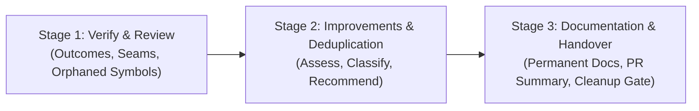

# Phase 5 — Lifecycle Finalize

## 1. Purpose

> **Core Mental Model:** Verify the whole picture. Clean up the codebase. Document the verified truth. Hand over with confidence.

Complete the development lifecycle by independently verifying the complete integrated implementation against its original goals and requirements, reviewing code quality and architecture, identifying improvement opportunities across the application, synchronizing permanent documentation, and delivering a clean handover.

The Agent should continuously look for opportunities to improve the implementation, but must obtain user approval before making any improvement beyond what is required by the approved task—even a minor one.

This phase progresses through three sequential stages:

1. **Verify & Review:** Verify that the integrated solution achieves the original Goal and requirements, and conduct an independent technical audit of code hygiene and integration seams.
2. **Improvement Assessment & Smart Deduplication:** Actively identify deduplication, cleanup, and enhancement opportunities across the feature and connected modules, presenting recommendations for user approval.
3. **Documentation & Handover:** Synchronize verified permanent documentation, log upstream lessons in `lifecycle/04-refine.md`, provide a copyable PR summary, and execute the user's artifact cleanup decision.

---

## 2. Guiding Principles

- **Verify Outcomes, Not Just Tasks:** Phase 4 verified individual implementation tasks. Phase 5 verifies the complete integrated system against the original Goal and Target Features from `lifecycle/01-discover.md`.
- **Audit Facts, Not Checklists:** A checked box in `lifecycle/03-plan.md` is a clue, not proof. Verify important behaviors through actual code, tests, and running system evidence.
- **Improve Proactively, Change Only With Approval:** Actively spot opportunities to improve code quality, performance, deduplication, and architecture across the feature and connected modules. Present recommendations with evidence and trade-offs. **Never implement an improvement beyond the approved scope—even a minor one—without explicit user approval.**
- **The Orphan Hunter Audit:** When screens, endpoints, or helpers are deleted, renamed, or consolidated, conduct a dedicated grep audit to ensure zero orphaned exports, dead route registrations, dangling imports, stale test mocks, or unused CSS linger in the project.
- **Smart Deduplication (Intra-Module vs. Cross-Module):**
  - *Intra-Module:* Consolidate duplicated helpers across touched files within the module's shared directory.
  - *Cross-Module:* Reuse existing shared components, but **never** edit shared infrastructure used by unrelated modules without explicit user permission.
- **Narrow Mechanical Fixes vs. Returning to Build:**
  - Narrow, mechanical defects on touched files (e.g., removing an unused import or fixing a typo) may be resolved in-place during Finalize.
  - Any behavioral, architectural, data-integrity, or security defect **must** return to Phase 4 — Build as a formal task.
- **Document Verified Truth Only:** Permanent documentation in `docs/` must represent the final verified implementation, not temporary plans or abandoned ideas.
- **Honest Global Evidence:** Distinguish pre-existing baseline test failures from regressions introduced by this feature. Report all test results honestly as `Passed`, `Failed`, or `Not Run`.
- **Preserve Lifecycle Artifacts by Default:** Never delete or move the `lifecycle/` directory without an explicit choice from the user at the Artifact Cleanup Gate.

---

## 3. Responsibilities & Sequence

Finalize progresses through three stages:



---

### Stage 1 — Verify & Review

**Objective:** Conduct an independent audit of the integrated system to confirm requirements are fulfilled and code quality meets project standards.

> **Fresh-Eyes Delegation (Optional):** When subagents are available, the main agent may invoke a read-only research/audit subagent to inspect the git diff and codebase with fresh eyes, synthesizing the evidence before proceeding.

1. **Verify Intended Outcomes & Requirements**
   - Trace each Target Feature from `lifecycle/01-discover.md` into the implementation and automated tests.
   - Verify that the core Goal is achieved and that critical user journeys function end-to-end.
   - Confirm edge cases (empty states, invalid inputs, network failures, session expirations) behave as designed.
2. **Audit Seams, Security & Invariants**
   - Check routes, navigation, state stores, and caller contracts across module boundaries.
   - Verify authorization and permission checks at the enforcement boundary (not merely hiding UI elements).
   - Check sensitive data handling, fail-closed behavior, and transaction integrity.
3. **Execute the Orphan Hunter Audit & Code Hygiene Check**
   - **Orphan Hunter Audit:** Run dedicated grep searches to ensure deleted or renamed screens, components, or API endpoints have zero lingering exports, dead route registrations, dangling imports, or orphaned test mocks.
   - Check modified files against assigned Rule Files (folder placement, naming conventions, file-size limits).
   - Ensure diff hygiene: verify zero leftover `console.log`, `debugger`, or temporary test shims.
4. **Global Verification Suite & Audit Record**
   - Run the project-level analyzer, linter, and full test suite.
   - Record exact commands and outcomes honestly (`Passed`, `Failed`, `Not Run`) in `lifecycle/05-finalize.md` under `## 1. Outcome & Quality Verification`. Distinguish pre-existing baseline issues from new code.
5. **Handle Findings**
   - *Narrow mechanical fix:* Fix trivial typos or unused imports in-place and re-verify.
   - *Behavioral or security defect:* Halt Finalize, record the finding, return to Phase 4 — Build, and implement a proper task.

---

### Stage 2 — Improvement Assessment & Smart Deduplication

**Objective:** Discover worthwhile improvements across the feature and connected modules, presenting evidence-backed recommendations for user decision.

1. **Identify Deduplication & Modernization Opportunities**
   - Search for duplicated logic across touched files that can be consolidated into module-level shared utilities.
   - Identify inconsistent patterns, deprecated dependencies, or unnecessary complexity introduced or exposed by the change.
2. **Apply the Smart Deduplication Boundary**
   - **Intra-Module:** Safe consolidation of helpers or sub-components within the active module.
   - **Cross-Module:** Never touch shared infrastructure or files consumed by unrelated modules without explicit user permission.
3. **Classify, Document & Recommend (Never Change Without Approval)**
   - Record every identified opportunity in `lifecycle/05-finalize.md` under `## 2. Assessed Improvements & Deduplication`.
   - For every worthwhile opportunity, present a concise recommendation in chat:
     - **Location:** Affected files and current behavior.
     - **Proposed Change:** What should change and the expected benefit.
     - **Recommendation:** Implement now (returns to Phase 4), plan as a follow-up task, or defer to future backlog.
   - **Wait for explicit user approval.** If approved, update `lifecycle/03-plan.md` and return to Phase 4 — Build to implement and verify the change. If declined or deferred, record the user's decision in `lifecycle/05-finalize.md` and proceed without editing.

---

### Stage 3 — Documentation & Handover

**Objective:** Synchronize permanent project knowledge, log upstream friction, present a copyable PR summary, and handle lifecycle artifacts.

1. **Synchronize Permanent Documentation via Documentation Treeing**
   Structure permanent project knowledge hierarchically from Trunk to Leaves:
   - **Level 1 (Trunk — Module README at `docs/modules/<module>/README.md`):** Module orientation page summarizing business purpose, core data models, feature directory index, and cross-module boundaries.
   - **Level 2 (Branches — Feature Document at `docs/modules/<module>/feature_<name>.md`):** Deep feature specification describing end-to-end primary workflows, alternate paths, and component touchpoints.
   - **Level 3 (Leaves — Invariants & Decisions):** Scoped non-negotiable Business Rules (`BR-X`) and Consequential Architectural Decisions (`DEC-X`).
   - **Root Updates (`README.md` / `GLOSSARY.md`):** Update only if setup, environment variables, commands, or project-wide terminology changed.
   - *Format Rule:* Document verified truth with scannable nested sub-bullets. Link rather than duplicate.
2. **Review Upstream Friction (`lifecycle/04-refine.md`)**
   - Review entries recorded in `lifecycle/04-refine.md` across earlier phases (or append any Finalize-specific friction) to synthesize actionable framework or project rule recommendations.
3. **Prepare Copyable PR Summary**
   Author a clean, evidence-based PR summary directly in `lifecycle/05-finalize.md` under `## 4. Copyable PR Summary` and present it in chat for the user to copy into GitHub/GitLab:
   - **Outcome Summary:** Problem solved and delivered user capability.
   - **Key Changes & Files:** Core files created or modified with 1-line descriptions.
   - **Verification Evidence:** Exact test runner commands, results, and manual check proofs.
   - **Known Limitations:** Any unrun checks or explicitly deferred edge cases.
4. **Execute the Artifact Cleanup Gate (Delete, Archive, or Keep)**
   Because `lifecycle/` contains temporary development artifacts (`01-discover.md`, `02-flows.md`, `03-plan.md`, `04-refine.md`, `05-finalize.md`) and permanent knowledge is now in `docs/`:
   - Run read-only `git status` to inspect existing lifecycle files.
   - Ask the user in chat to make the **Artifact Decision for `lifecycle/`**:
     - **1. Delete:** Remove the temporary `lifecycle/` directory (cleanest; docs already committed in `docs/`).
     - **2. Archive:** Move `lifecycle/` to an archive location (e.g. `docs/archive/<feature-name>/`).
     - **3. Keep:** Retain the `lifecycle/` directory in place (default).
   - **Stop and wait for the user's explicit choice.** Never delete or move `lifecycle/` without explicit user permission.
   - Execute only the authorized choice.

---

## 4. Completion Criteria

Phase 5 is complete only when:

- All Target Features and the core Goal from `lifecycle/01-discover.md` are verified against actual code and test evidence.
- The integrated system passes the technical code audit (seams, security invariants, orphaned symbols check, diff hygiene).
- Global test suite and analyzer have been run and results are honestly documented.
- Improvement assessment was performed; all recommendations were either approved, declined, or deferred by the user.
- Permanent documentation (`docs/modules/...`) accurately reflects the final verified implementation.
- Upstream friction in `lifecycle/04-refine.md` (if any) is reviewed and addressed.
- Copyable PR summary is presented in chat.
- The user has made the Artifact Cleanup Decision and the authorized action is executed.
- All rows in `lifecycle/00-status.md` are marked `Done`.

---

## 5. Exit Gate

The Exit Gate marks the formal conclusion of the entire development lifecycle.

### Conditions for Exit Approval
1. All verification and code quality checks are satisfied.
2. Permanent documentation is synchronized and verified.
3. The user has reviewed the PR summary and provided explicit final approval in chat.
4. The user has selected the Artifact Cleanup action and the action has been performed.

### Exit Gate Outcomes
- **Approved:** All phases in `lifecycle/00-status.md` are marked `Done`. The feature is officially complete and the working tree is ready for the user's manual git commit.
- **Changes Requested:** Feedback requires corrections. Narrow fixes are addressed in-place; substantive defects return to Phase 4 — Build.
- **Blocked:** A critical architectural invariant, security failure, or regression remains unresolved. Halt and escalate to the user with evidence.

### Requesting User Approval
Follow the **Phase 0 Chat Approval Protocol** to present verified outcomes, updated permanent docs, the copyable PR Summary, and request the **Artifact Decision for `lifecycle/`** (Delete, Archive, Keep).

---

## 6. Phase Boundary

### 6.1 What Belongs to Phase 5 (Finalize)
- Integrated feature and outcome verification against original Discover goals.
- Independent technical code audit (seams, security, invariants).
- Checking for orphaned exports, dead routes, dangling imports, and leftover debug code.
- Running project-wide test suites and static analysis.
- Identifying and recommending improvement opportunities across the application.
- Synchronizing permanent documentation in `docs/modules/`, `README.md`, and `GLOSSARY.md`.
- Reviewing and actioning workflow friction in `lifecycle/04-refine.md`.
- Authoring the copyable PR summary in chat.
- Executing the user's explicit artifact cleanup decision.

### 6.2 What Does NOT Belong to Phase 5
- Implementing new features or expanding scope independently (belongs to Phase 1 — Discover).
- Implementing major refactors or behavioral fixes without returning to Phase 4 — Build.
- Making unapproved improvements—even minor ones—without explicit user approval.
- Modifying shared cross-module infrastructure without explicit authorization.
- Deleting or moving the `lifecycle/` directory without an explicit choice from the user.

---

## 7. Phase Output

The deliverables of Phase 5 are:

1. **Finalize Audit & Handover Document:** `lifecycle/05-finalize.md` capturing verification proof, assessed improvements, permanent doc links, and copyable PR summary.
2. **Synchronized Permanent Documentation:** Updated files under `docs/modules/<module>/README.md`, `docs/modules/<module>/feature_<name>.md`, or root `README.md`.
3. **Completed Status Dashboard:** `lifecycle/00-status.md` showing all phases marked `Done`.
4. **Reviewed Refinement Log (`lifecycle/04-refine.md` — Optional):** Upstream friction reviewed for central skills improvement.

### Recommended Structure for `lifecycle/05-finalize.md`

```markdown
# Finalize: [Requirement / Feature Name]

## 1. Outcome & Quality Verification

### Target Feature Traceability
- **[Feature 1]:** Verified against unit tests and manual user steps.
- **[Feature 2]:** Verified against Cloud Functions integration tests.

### Technical & Quality Audit
- **Orphan Hunter Audit:** Ran grep on deleted/renamed symbols; 0 orphaned routes, exports, or dead mocks found.
- **Diff & Code Hygiene:** Zero temporary test shims, debug logs, or style violations across touched files.

### Global Verification Suite
| Suite / Command | Scope | Result | Details |
| :--- | :--- | :--- | :--- |
| `npm test` | Unit / Integration Tests | `Passed` | 42 passed, 0 failed |
| `flutter analyze` | Static Analysis | `Passed` | 0 issues found |

## 2. Assessed Improvements & Deduplication
- **Opportunity 1:** [Location, Proposed Change, User Decision: Approved (created Task 4.x) / Deferred / Declined]

## 3. Permanent Documentation
- [`docs/modules/<module>/README.md`](file:///path/to/docs/modules/...): Updated module scope and schema tables.
- [`docs/modules/<module>/feature_<name>.md`](file:///path/to/docs/modules/...): Authored complete feature workflows and invariants.

## 4. Copyable PR Summary
### Summary of Changes
[1-2 paragraph high-signal summary of what this PR introduces and delivers]

### Key Files Changed
- `path/to/file1.ext`: [1-line description of changes]
- `path/to/file2.ext`: [1-line description of changes]

### Verification Evidence
- [Exact test commands run and green results]
- [Manual user verification steps confirmed]
```

### Recommended Structure for `docs/modules/<module>/README.md`

```markdown
# Module: <Module Name>

## 1. At a Glance
- **Purpose:** <1-line summary of what business area this module owns>
- **Owns:** <Core responsibilities or data models>
- **Does not own:** <Important ownership boundary or delegated responsibilities>

## 2. Shared Concepts & Data Models
- **`<Core Model / Entity>`:** `<path/to/model.ext>` — <1-line purpose in this module>

## 3. Data & Storage Schemas
- **`<collection_or_table>`** (`key: <auto-id / userId>`): <1-line purpose, key fields, and consistency rules>

## 4. Feature Directory Index
- **[`feature_<name_1>.md`](feature_<name_1>.md):** <1-line capability summary>

## 5. Scope Boundaries & Cross-Module Dependencies
- **Consumes:** `<Module / Service>`: <Data or event read/consumed>
- **Exposes:** `<Service / Stream / Event>`: <Public API contract exposed to callers>
- **Delegated ownership:** `<Capability>`: <Which module owns this responsibility instead>
- **Deferred (Future Backlog):** `<Deferred Idea>`: <1-line summary and why deferred>
```

### Recommended Structure for `docs/modules/<module>/feature_<name>.md`

```markdown
# Feature: <Feature Name>

## At a Glance
- **Problem:** <1-line user or operational pain this feature addresses>
- **Capability:** <1-line summary of what this feature enables>
- **Entry point:** `<Route /items, button on FeatureCard, or background push event>`

## 1. Primary Workflow
1. <User action or trigger event>
2. <Validation, state transition, or controller/repository dispatch>
3. <Observable UI or persistence result>

## 2. Important Alternate & Failure Paths
- **Empty / first use:** <Behavior when 0 records exist or unconfigured>
- **Validation / error / offline:** <Failure behavior and recovery>
- **Permissions / tenancy:** <Allowed vs. denied behavior>
- **Concurrency / retry:** <Debounce, lock, idempotency, or stale-state guard>
- **Data lifecycle / side effects:** <Linked records, audit trail, migration, or cleanup>

## 3. Business Rules & Module Invariants
- **BR-1 (`<Rule Name>`):** <1-line state, calculation, or validation law>
- **BR-2 (`<Rule Name>`):** <1-line permission, lifecycle, or consistency law>

## 4. Architecture & File Touchpoints
- **Controllers & State:** `<path/to/file>` — <1-line responsibility>
- **Views & UI Components:** `<path/to/file>` — <1-line responsibility>
- **Data & Validators:** `<path/to/file>` — <1-line responsibility>
- **Routes & Integrations:** `<path/to/file>` — <1-line responsibility>

## 5. Security, Tenancy & Operational Constraints
- **Authorization:** <Permission or role required and where access is enforced>
- **Tenant / resource isolation:** <How tenant filtering is enforced on reads/writes>
- **Fail-closed policy & audit:** <What happens when credentials/permissions fail and what is logged>

## 6. Consequential Architectural Decisions
- **Decision 1 (`<Topic>`):**
  - Chosen: <1-line confirmed approach>
  - Why: <Evidence and main trade-off>
  - Alternative rejected: <Meaningful alternative and why it was not selected>
  - Consequences / revisit trigger: <Risk or condition that would justify revisiting>
```
