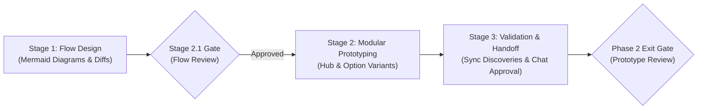

# Phase 2 — Lifecycle Flows

## 1. Purpose

> **Core Mental Model:** Visualize the journey. Highlight what changes. Validate the experience with modular interactive prototypes before writing code.

The purpose of this phase is to transform confirmed requirements from Phase 1 (`lifecycle/01-discover.md`) into validated visual flows and user experience designs before technical implementation planning begins.

This phase has two sequential stages:

1. **Flow Design:** Understand and visualize how the feature, user journey, or system process works through clear flow diagrams (using Mermaid).
2. **Modular Prototyping:** For user-facing features, create lightweight, modular HTML prototypes to test UX alternatives, interaction states, and interface behavior.

### UI vs. Non-UI / Backend Path

- **User-Facing / UI Changes:** Both Stage 1 (Flow Design) and Stage 2 (Prototyping) are mandatory. Stage 1 models user journeys, decision branches, and transitions; Stage 2 models interactive UI screens, states, and controls in modular HTML prototypes.
- **Non-UI / Backend / API / Architecture Changes:** Stage 1 is mandatory and focuses on system architecture, API sequence diagrams, data flows, and state machines. Stage 2 (Prototyping) is **explicitly skipped / marked N/A**, and the phase proceeds directly to Phase 3 — Plan once Stage 1 flows are approved.

---

## 2. Guiding Principles

- **Understand Before Designing:** Ground every flow and prototype directly in the confirmed requirements from `lifecycle/01-discover.md`. Do not invent business rules or silently resolve product ambiguities.
- **Zero Dead-Ends Law:** Every failure, validation, or error branch in flowcharts must loop back to a recovery action or explicit exit. An orphaned error box terminating in a dead end is an invalid flow.
- **Flow & State Treeing:** Tree flows systematically: Primary Happy Path (Trunk) $\to$ Alternate Scenarios (Branches) $\to$ Edge & Error Recovery Loops (Leaves).
- **Visualize Before Prototyping:** Model and validate flow diagrams before writing HTML prototype code.
- **Highlight What Changes:** For modifications to existing systems, distinguish current behavior from proposed behavior using side-by-side visual diffs or concise change delta tables.
- **1-Hypothesis Prototype Fork:** Every comparative option (Option A vs. Option B) must test a singular, explicit UX/architectural hypothesis (e.g., Speed of Entry vs. Guided Error Prevention; Inline Modeless vs. Isolated Modal). Cosmetic or color variations do not count as distinct options.
- **Scale Exploration to Uncertainty:**
  - *Focused (1 option):* Minor adjustments or flows following established design conventions.
  - *Comparative (2 options):* Meaningful UX decisions with two viable interaction models.
  - *Broad (up to 3 options):* Complex or novel workflows with structurally distinct approaches.
- **Prevent "God-File" Prototypes:** Never create monolithic single-file prototypes for multi-feature or multi-variant projects. Use a central Prototype Hub (`lifecycle/02-prototype.html`) linking to focused, self-contained option files in `lifecycle/prototype/<feature>/`. Prototypes are temporary validation artifacts—prioritize realistic interaction and modularity over arbitrary line-count limits.
- **Interactive State Toggling:** Every prototype option must feature a sticky top state-switcher bar allowing instant toggling between key interactive states (`Default`, `Empty`, `Loading`, `Error`, `Edge / Restricted`).
- **Self-Contained & Zero-Build:** Prototypes must open directly in any browser with zero build steps, bundlers, or local servers. Embed styles, mock data, and minimal vanilla JS directly in each file.
- **Synchronize Discoveries Upstream:** If prototyping reveals missing requirements, edge cases, or UX simplifications, immediately update `lifecycle/01-discover.md` in place.
- **Single Live Document (`lifecycle/02-flows.md`):** All flow diagrams, prototype references, and UX decisions live in `lifecycle/02-flows.md`.

---

## 3. Responsibilities & Sequence

Phase 2 progresses through three clean stages with explicit human gates:



---

### Stage 1 — Flow Design

**Objective:** Map confirmed requirements into clear, unambiguous visual flows that represent happy paths, alternative branches, and edge cases.

1. **Review Confirmed Requirements**
   - Read `lifecycle/01-discover.md`. Ensure all target features, scope boundaries, and decisions are understood.
   - Trace caller ripples using read-only codebase searches to understand existing workflows that intersect the change.

2. **Model Flows via Flow Treeing (Trunk to Leaves)**
   - **Level 1 (Trunk — Happy Path):** Author Mermaid flowcharts or sequence diagrams representing the primary journey from user entry to successful completion.
   - **Level 2 (Branches — Scenarios):** Model user decision forks, alternative pathways, role permissions, and conditional sub-flows.
   - **Level 3 (Leaves — Recovery & Edges):** Model edge conditions, timeout branches, and error recovery loops, strictly enforcing the **Zero Dead-Ends Law**.
   - **Feature-Driven Flow Modeling:** Group visual workflows directly by the Target Feature names from Discover, ensuring direct 1:1 traceability from requirement to visual execution without duplicating Discover's current-system analysis.

3. **Verify Flow Completeness & The Zero Dead-Ends Law**
   - **Enforce Zero Dead-Ends:** Verify that every error branch, validation failure, and timeout loops back to an actionable user recovery step or a safe exit. Never leave an orphaned error box.
   - Check against edge cases: empty states, invalid inputs, network failures, session timeouts, and permission boundaries.
   - Ensure caller contracts remain backward-compatible unless explicit breaking changes are approved.
   - Document flows in `lifecycle/02-flows.md` under `## 2. Visual Workflows & Sequences`.

4. **Stage 1 Exit Gate (Flow Design Approval Gate)**
   - Once flows are documented in `lifecycle/02-flows.md`, update row `2.1 Flow Design` to `In Review` in `lifecycle/00-status.md`.
   - Stop calling tools immediately.
   - Follow the **Phase 0 Chat Approval Protocol** to present the visual workflows in chat and request explicit user approval.
   - **Stop and wait for user approval.** Never proceed to Stage 2 (Modular Prototyping) or generate prototype code in the same turn without explicit user approval of the flow design.
   - **Gate Outcome:**
     - *If Approved:* Mark `2.1 Flow Design` as `Done` in `00-status.md`. For UI tasks, set `2.2 Interactive Prototype` to `In Progress` and advance to Stage 2. For pure backend/non-UI tasks, mark `2.2` as `Skipped (N/A)` and advance directly to Phase 3 — Plan.
     - *If Changes Requested:* Keep `2.1 Flow Design` as `In Progress`, revise `02-flows.md`, and re-present.

---

### Stage 2 — Modular Prototyping

**Objective:** Translate approved flows into interactive browser prototypes to validate UX decisions, screen layouts, and state transitions before planning technical tasks.

> **Applicability Note:** Pure non-UI / backend changes explicitly skip this stage. Mark Stage 2 as `Skipped (N/A)` in `lifecycle/00-status.md` and proceed directly to Stage 3.

1. **Select Exploration Depth & Apply the 1-Hypothesis Fork**
   - Assess UX uncertainty and determine the number of options: Focused (1), Comparative (2), or Broad (3).
   - **1-Hypothesis Fork:** Ensure each option tests a singular, distinct hypothesis (e.g., Option A: Speed of Entry via in-place table editing vs. Option B: Error Prevention via a dedicated slide-over wizard).
   - Document the specific design decision and trade-off in `02-prototype.html`.

2. **Directory Structure (Modular Hub Architecture)**
   To keep files maintainable and prevent context truncation, organize prototypes using this structure:

   ```text
   lifecycle/
   ├── 02-flows.md             # Primary flow documentation and decisions
   ├── 02-prototype.html       # Central Hub: feature index, option trade-offs, decision cards
   └── prototype/
       └── <feature-slug>/     # e.g., auth, dashboard, billing
           ├── option-a.html   # Self-contained variant A
           └── option-b.html   # Self-contained variant B
   ```

3. **Build Self-Contained Prototype Options**
   - **Focused Scope:** Keep each option file focused on the specific screen or workflow being tested. Do not degrade prototype quality, strip realistic mock data, or omit important interactive states to satisfy an arbitrary line limit—it is a throwaway validation artifact.
   - **Self-Contained:** Include inline `<style>` and minimal vanilla JS inside each HTML file. Avoid external CSS frameworks that require npm/build tooling (modern CSS or Tailwind via CDN is acceptable).
   - **Prototype State Treeing (Sticky State-Switcher Bar):** Every option must include a sticky header bar with buttons to toggle between the full state tree instantly:
     - **Trunk (Default / Populated):** Standard loaded state with realistic mock data.
     - **Leaves (Edge States):**
       - `Empty`: Zero-data state with onboarding cues.
       - `Loading`: Skeletons, spinners, or disabled interaction states.
       - `Error / Validation`: Field-level errors, banner alerts, retry prompts.
       - `Edge / Permissions`: Restricted view, read-only state, or modal confirmation.
   - **Async Communication Drawer:** For multi-step asynchronous flows (e.g., email verification links, magic links, SMS OTPs), embed a simulated collapsible drawer or modal in the prototype so reviewers can inspect payloads and click links directly without external servers or URL hacking.

4. **Assemble the Central Prototype Hub (`lifecycle/02-prototype.html`)**
   - Provide an index of all prototype options organized by feature.
   - Include a **"Needs Decision"** banner highlighting the specific trade-offs between options (e.g., Option A optimizes for speed; Option B optimizes for guided context).
   - Embed lightweight Mermaid sub-flow diagrams where visual process context clarifies the screen being viewed.

---

### Stage 3 — Validation, Requirements Sync & Approval

**Objective:** Synchronize discoveries into requirements and obtain explicit user sign-off.

1. **Synchronize Discoveries Upstream**
   - If prototyping reveals an unhandled edge case, conflicting requirement, or valuable simplification, immediately update `lifecycle/01-discover.md` in place.
   - Record UX decisions in `lifecycle/02-flows.md` under `## 3. Key UX & Interaction Decisions`.

2. **Obtain User Approval**
   - Advance to the Exit Gate and present deliverables following the **Phase 0 Chat Approval Protocol**.

---

## 4. Completion Criteria

Phase 2 is complete only when all the following conditions are met:

### 4.1 Flow Design Completion
- Flow diagrams cover entry points, primary happy paths, decision branches, alternative flows, and error recovery.
- Side-by-side visual diffs or delta tables clearly distinguish current from proposed behavior where existing workflows change.
- All flows accurately reflect the confirmed requirements from `lifecycle/01-discover.md`.
- Flows are documented in `lifecycle/02-flows.md`.

### 4.2 Prototyping Completion (UI Changes)
- Prototypes follow the modular hub structure (`02-prototype.html` index hub + `prototype/<feature>/option-X.html`).
- Each option file is self-contained, functionally complete, and opens directly in a browser.
- Interactive state-switcher bar allows toggling between Default, Empty, Loading, Error, and Edge states.
- Async flows (emails, tokens) feature a simulated test drawer for end-to-end link inspection.
- Prototype options are linked with trade-offs described in `lifecycle/02-prototype.html`.
- For pure backend changes, Prototyping is explicitly recorded as `Skipped (N/A)`.

### 4.3 Discoveries & Requirements Sync
- Any requirement changes or edge cases uncovered during flow modeling or prototyping are updated in `lifecycle/01-discover.md` in place.
- Key UX decisions are logged with rationale in `lifecycle/02-flows.md`.

---

## 5. Exit Gate

The Exit Gate determines whether Phase 2 is authorized to advance to Phase 3 — Plan.

### Conditions for Exit Approval
1. Flow Design is complete and documented in `lifecycle/02-flows.md`.
2. Prototyping is complete in `lifecycle/02-prototype.html` (or confirmed `Skipped (N/A)` for backend tasks).
3. Discoveries and edge cases are synchronized with `lifecycle/01-discover.md`.
4. The user has explicitly approved the flows and selected prototype options in chat.

### Exit Gate Outcomes
- **Approved:** All conditions satisfied. Mark Phase 2 as `Done` in `lifecycle/00-status.md`, load `lifecycle-plan`, and advance to Phase 3 — Plan.
- **Changes Requested:** Feedback requires revisions. Update `lifecycle/02-flows.md` or prototype files, re-verify, and present a concise summary.
- **Blocked:** An unresolved design question, architectural constraint, or requirement conflict blocks progress. Return to Phase 1 — Discover or request clarification.

### Requesting User Approval
Follow the **Phase 0 Chat Approval Protocol** to present `lifecycle/02-flows.md` (and `lifecycle/02-prototype.html` if UI) and request approval to advance to Phase 3 — Plan.

---

## 6. Phase Boundary

### 6.1 What Belongs to Phase 2 (Flows)
- Visual process flowcharts, sequence diagrams, and state machines in Mermaid.
- Side-by-side current vs. proposed visual diffs and change delta tables.
- Building modular HTML prototypes and option variants in `lifecycle/prototype/`.
- Creating sticky top interactive state switchers and async message inspection drawers.
- Demonstrating screen transitions, interaction patterns, and edge UI states.
- Synchronizing discovered requirements back into `lifecycle/01-discover.md`.
- Documenting flow deliverables and UX decisions in `lifecycle/02-flows.md`.

### 6.2 What Does NOT Belong to Phase 2
- Writing production application code or modifying repository source files (belongs to Phase 4 — Build).
- Creating production database migrations, backend schemas, or service architectures (belongs to Phase 3 — Plan and Phase 4 — Build).
- Breaking down implementation tasks or estimating engineering effort (belongs to Phase 3 — Plan).
- Reopening scope or redefining business goals independently without user approval.
- Treating prototype HTML/JS code as production code.

---

## 7. Phase Output

The primary deliverable is `lifecycle/02-flows.md`, supported by `lifecycle/02-prototype.html` and `lifecycle/prototype/` for UI features.

### Recommended Structure for `lifecycle/02-flows.md`

```markdown
# Flows: [Requirement / Feature Name]

## 1. At a Glance

- **The Core Journey:** [1-sentence summary of what this end-to-end user flow accomplishes].

- **UI Prototypes:**
  - **Prototype Hub:** [02-prototype.html](02-prototype.html) *(or "Skipped (N/A for Non-UI)")*
  - **[Screen 1 / Workflow Name]:** [Option B](prototype/<feature>/screen-1-b.html) ([Short title]) selected over Option A ([Short title & why rejected]).
  - **[Screen 2 / Workflow Name]:** [Option A](prototype/<feature>/screen-2-a.html) ([Short title]) selected over Option B ([Short title & why rejected]).

- **Key Interaction Rules (UX Decisions):**
  - **DEC-01 ([Topic / Copy]):** [Plain-language terminology or dialog copy]
  - **DEC-02 ([Topic / Protection]):** [Current device attribution or state protection]
  - **DEC-03 ([Topic / Zero Dead-Ends]):** [Inline retry banner on failure rather than trapped modal]
  - **DEC-04 ([Topic / Navigation]):** [Exact navigation entry point]

## 2. Visual Workflows & Sequences

- **Workflow 1: [Feature 1 Name]:**
  ```mermaid
  sequenceDiagram
    autonumber
    ...
  ```

- **Workflow 2: [Feature 2 Name]:**
  ```mermaid
  sequenceDiagram
    autonumber
    ...
  ```
  - **Zero Dead-Ends Error Recovery:**
    ```mermaid
    flowchart TD
      ...
    ```
```
