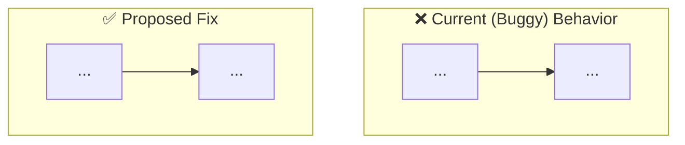
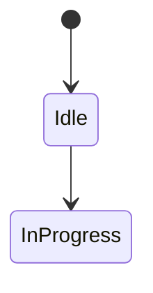
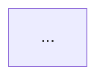
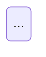

# Define: <Feature or Module Name>

> **Interactive Prototype:** [prototype.html](./prototype.html) <!-- Required for UI features (use [prototype/index.html](./prototype/index.html) for multi-screen modules); omit for pure backend -->

## 1. Goal

- **Problem:** <What is the current state, and why is it a problem?>
- **Outcome:** <What should be true when the work is complete?>

## 2. Visual Models (Human Review Aid)

> [!NOTE]
> **Dual-Audience Law:** Visual models exist to eliminate mental compilation and verify behavior/edge cases for human review. Agents must NEVER use this diagram as a shortcut to skip or override the detailed technical contracts in **List of Changes** and **Decisions**.

<!-- 
MANDATORY: Provide at least one focused Mermaid diagram tailored to the task type:

1. FOR BUG FIXES: Dual-path diagram showing [Current (Buggy) Behavior] vs [Proposed Fix].

2. FOR WORKFLOWS / LOGIC / BACKEND: State machine or decision tree showing states, transitions, and edge cases.

3. FOR MULTI-FEATURE / FULL MODULES: Break into modular sub-flows matching each feature/subsystem (never one giant spaghetti diagram).
### Flow 1: <Sub-Journey / Feature Name>

### Flow 2: <Sub-Journey / Feature Name>

-->

## 3. Success Criteria

- <Observable, measurable condition of success 1>
- <Observable, measurable condition of success 2>

## 4. List of Changes

### <Screen / Area / Subsystem>
- **<Add | Update | Remove | Fix>:** <Short description of the specific change>

## 5. Out of Scope

- **<Excluded Feature>:** <Why it is excluded or deferred for this iteration>

## 6. Decisions

### Technical
- **<Decision Topic>:** <Security, performance, API contract, or architecture decision>

### Business Logic
- **<Rule Topic>:** <Core domain rule, system invariant / guardrail, or validation behavior>
<!-- Optional: If complex thresholds, formulas, or multi-condition rules exist, use a concise Boundary Truth Table instead of long paragraphs:
- **<Rule Name>:**
  | Condition A | Condition B | Expected Result | Rule / Edge Case |
  | :--- | :---: | :---: | :--- |
  | ... | ... | ... | ... |
-->
