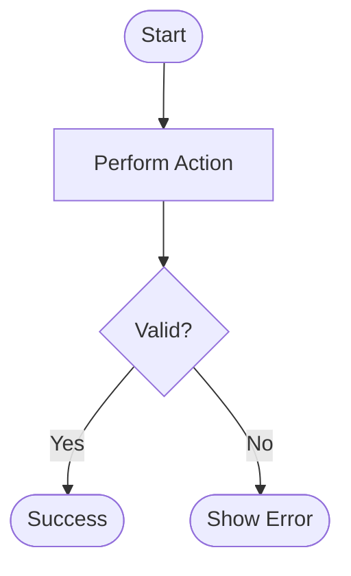

# Requirements: <Feature Name>

## 1. Problem & Outcome Summary
- **Core Problem (The "Why"):** <1–2 sentences explaining the user or operational pain point.>
- **Observable Outcome:** <What works when this is complete and in production.>
- **Second-Order Ripple Effects:** <What upstream/downstream callers, data models, or state flows are affected?>

## 2. Existing Code & Reuse Touchpoints
- **Target Modules / Paths:** `<path/to/module>`
- **Reusable Models & DTOs:** `<ExistingModel>`
- **Reusable Widgets & Components:** `<ExistingWidget>`
- **Reusable Utilities / Services:** `<ExistingService>`
- **Applicable Project Rules:** `.agents/rules/<rule>.md`

## 3. Requirements & Acceptance Criteria
- [ ] **REQ-1 (<Feature Capability>):** <Description of user-facing capability>
  - [ ] **AC-1.1:** <Binary testable condition>
  - [ ] **AC-1.2:** <Binary testable condition>
- [ ] **REQ-2 (<Feature Capability>):** <Description>
  - [ ] **AC-2.1:** <Binary testable condition>

## 4. Business Rules & Domain Invariants
*(Inviolable domain laws that must always hold true. These are synced to `docs/modules/<module>.md` in Finalize.)*
- **BR-1 (<Rule Name>):** <Domain invariant, e.g. "Coupons cannot reduce order total below $0.00.">
- **BR-2 (<Rule Name>):** <Calculation/state constraint, e.g. "Only one active promotion can be applied per checkout session.">
- **BR-3 (<Rule Name>):** <Lifecycle/security rule, e.g. "Archived records cannot be modified or re-activated.">

<!-- Optional: For complex multi-condition calculations or state transitions, use a Boundary Truth Table:
| Condition A | Condition B | Expected Result | Rule / Invariant |
| :--- | :--- | :--- | :--- |
| Active User | Order Total > $50 | 10% Discount Applied | BR-Promo-1 |
-->

## 5. 5-Lens Invariants & Gap Analysis
<!-- For New Features: Interrogate the 5 Lenses -->
- **Empty / First-Time State:** <What renders when 0 records exist.>
- **Validation & Error / Offline State:** <Input constraints, error messages, and retry recovery.>
- **Permissions, Roles & Tenancy:** <Allowed roles and tenant isolation boundaries.>
- **Concurrency & Idempotency:** <Debounce, locking, and duplicate submit safeguards.>
- **Data Lifecycle & Side Effects:** <Cascading deletes, archives, schema migrations, Firestore rules/indexes.>

<!-- For Bug Fixes & Refactors: Interrogate Root Cause -->
- **Current (Broken) vs. Expected (Fixed) Behavior:** <Exact difference.>
- **Root Cause Mechanism:** <Why the code failed.>
- **Regression Guardrail:** <Exact test or invariant that prevents reoccurrence.>

## 6. Architectural & Technical Decisions
- **Decision 1 (<Topic>):** <Chosen approach.>
  - **Alternatives Considered:** <Alternative options evaluated and trade-offs.>
  - **Trade-off Rationale:** <Why this decision was chosen.>

## 7. Glossary Updates (Staged)
- `<Domain Term>`: <Agreed unambiguous definition (to be synced to GLOSSARY.md in Finalize).>

## 8. Deferred Requirements (Future Scope)
- `<Feature Idea>`: <Deferred rationale.>

## 9. Selected UI/UX Specification
*(Populated during Prototype)*
- **Selected Component Variants:** <e.g. Card Option 1, Dialog Option 3>
- **State Behavior:** <Confirmed interaction states>

## 10. Flows & Logic Diagrams
<!-- 
1. New Features / Logic: flowchart TD or stateDiagram-v2 (5–10 nodes max per diagram).
2. Bug Fixes / Refactors: Dual-path flowchart contrasting [❌ Current (Buggy) Behavior] vs [✅ Proposed Fix].
-->

## 11. Open Items (Must be 100% empty at sign-off)
- **Open Questions:**
  *(None - all resolved)*
- **Open Research:**
  *(None - all resolved)*
